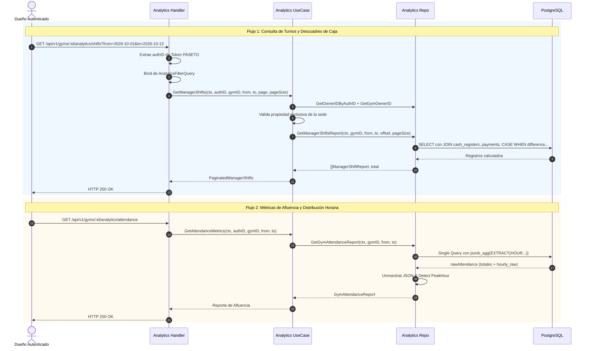

# 📈 Feature: Métricas, Historiales y Consultas Complejas (`features/analytics`)

Documentación técnica y funcional del módulo de **Analítica, Reportes Ejecutivos y Métricas (`Analytics`)** en **Fitbase**.

---

## 1. Propósito y Alcance del Módulo

El módulo `analytics` proporciona a los dueños de gimnasio (`Owner`) tableros de control ejecutivos y reportes analíticos de alta fidelidad, diseñados para auditar el desempeño operativo, comercial y de afluencia de sus sucursales físicas.

Áreas cubiertas por el módulo:
1. **Auditoría de Turnos y Descuadres de Caja (`GET /api/v1/gyms/:id/analytics/shifts`)**: Supervisa cada turno de caja física de los encargados, contrastando el fondo inicial (`open_cash`), el total en efectivo cobrado en sistema y el arqueo final reportado (`close_cash`) para detectar faltantes o sobrantes de dinero.
2. **Afluencia y Horas Pico (`GET /api/v1/gyms/:id/analytics/attendance`)**: Computa el volumen total de accesos físicos, identifica la hora pico de mayor concurrencia y desglosa las entradas por tipo (Membresía, Pase de un Día o Invitado) junto con su distribución horaria (0 a 23 hrs).
3. **Reporte Financiero Cruzado (`GET /api/v1/gyms/:id/analytics/revenue`)**: Cruza los ingresos netos recaudados desglosados simultáneamente por método de pago (Efectivo, Tarjeta, Transferencia, etc.) y por plan de membresía.
4. **Visión 360° del Cliente (`GET /api/v1/gyms/:id/analytics/clients/:user_id`)**: Consolida la vida completa de un cliente dentro de una sede: total gastado, asistencias acumuladas, suscripciones pasadas/activas, historial de pagos y últimas visitas.
5. **Dashboard Consolidado del Dueño (`GET /api/v1/gyms/:id/analytics/dashboard-summary`)**: Entrega en un único viaje a la base de datos (Single Round-Trip) todos los KPIs principales (ingresos, transacciones, suscriptores activos, check-ins y hora pico), junto con las últimas 5 transacciones y los últimos 5 turnos de caja para poblar la pantalla de inicio del administrador de forma instantánea.

---

## 2. ¿Qué se implementó?

### 2.1. Entidades y DTOs (`internal/features/analytics/domain.go`)

- **DTOs de Entrada (`Query Request`)**:
  - `AnalyticsFilterQuery`: Filtros estandarizados con `from`, `to`, `page`, `page_size` y método `Normalize()`.
- **DTOs de Salida (`Response`)**:
  - `ManagerShiftReport`: Detalle de turno con estado de cuadre (`ShiftID`, `ManagerName`, `OpenCash`, `CloseCash`, `TotalCollected`, `Difference`, `Status`).
  - `PaginatedManagerShifts`: Listado paginado de turnos de caja.
  - `GymAttendanceReport`: Métricas de visitas con `HourlyDistribution` (`hour`, `count`) y detección de `PeakHour`.
  - `RevenueCrossedReport`: Ingresos totales agrupados en un solo objeto con `ByPaymentMethod` y `ByPlan`.
  - `ClientMembershipHistoryReport`: Ficha integral de cliente con `Subscriptions`, `Payments` y `RecentCheckIns`.
  - `DashboardKPIs`: Indicadores clave (`total_revenue`, `total_transactions`, `active_subscribers`, `total_check_ins`, `peak_hour`, `peak_hour_count`).
  - `DashboardRecentPayment`: Vista resumida de pagos recientes (`id`, `amount`, `payment_method_name`, `payment_status_name`, `payment_date`).
  - `DashboardRecentShift`: Vista resumida de turnos recientes (`shift_id`, `manager_name`, `open_time`, `close_time`, `open_cash`, `status`).
  - `DashboardSummaryReport`: Contenedor consolidado con sede, KPIs, pagos recientes y turnos recientes.

### 2.2. Casos de Uso (`internal/features/analytics/usecase.go`)

- `validateOwnerAccess(...)`: Valida rigurosamente que el usuario autenticado sea el Dueño propietario de la sede consultada. Si no lo es, retorna `errorsx.ErrUnauthorized`.
- `parseDateRange(...)`: Normaliza fechas de filtro (`YYYY-MM-DD`), extendiendo la fecha final al último milisegundo del día (`23:59:59.999999999`).
- `GetManagerShifts(...)`: Obtiene la auditoría de turnos paginada.
- `GetAttendanceMetrics(...)`: Obtiene el reporte de afluencia y distribución horaria.
- `GetCrossedRevenue(...)`: Obtiene la matriz de ingresos cruzados.
- `GetClientHistory(...)`: Obtiene la ficha consolidada del cliente.
- `GetDashboardSummary(...)`: Resuelve en una sola llamada el reporte ejecutivo integral para el panel de administración.

### 2.3. Repositorio (`internal/features/analytics/repository.go`)

- Todas las consultas están construidas conforme a la regla de **Single Round-Trip Query**, combinando:
  - `Select(...)` multilínea con backticks.
  - `CASE WHEN` calculados directamente en PostgreSQL para semántica de negocio y diferencias contables.
  - Subconsultas con `jsonb_agg` y `jsonb_build_object` para colecciones hijas asociadas en una sola consulta.
  - Mapeo directo de resultados con `.Scan(&report)`.
- `GetDashboardSummary(ctx, gymID)`: Query consolidado con joins optimizados a `payments`, `subscriptions`, `check_ins` y `cash_registers`.
- `GetGymOwnerID` y `GetOwnerIDByAuthID` para validación de propiedad y prevención IDOR.

### 2.4. Endpoints HTTP y Controladores

| Método | Ruta | Middleware | Descripción |
| :--- | :--- | :--- | :--- |
| `GET` | `/api/v1/gyms/:id/analytics/shifts` | `Auth`, `Idempotency` | Reporte paginado de turnos y descuadres de caja |
| `GET` | `/api/v1/gyms/:id/analytics/attendance` | `Auth`, `Idempotency` | Métricas de afluencia, hora pico y distribución horaria |
| `GET` | `/api/v1/gyms/:id/analytics/revenue` | `Auth`, `Idempotency` | Ingresos cruzados por método de pago y por plan |
| `GET` | `/api/v1/gyms/:id/analytics/clients/:user_id` | `Auth`, `Idempotency` | Historial 360° consolidado de un cliente |
| `GET` | `/api/v1/gyms/:id/analytics/dashboard-summary` | `Auth`, `Idempotency` | Resumen ejecutivo consolidado del dashboard en un solo request |

---

## 3. ¿Por qué se tomaron estas decisiones técnicas? (ADR)

### 3.1. Single Round-Trip Query con `jsonb_agg`
- **Decisión**: Los reportes que integran colecciones (como distribución por horas, desglose por métodos y planes, o historial de pagos de un socio) se obtienen mediante subconsultas con `jsonb_agg` en una sola sentencia SQL.
- **Justificación**: Elimina por completo el problema N+1 y minimiza la latencia de red entre Go y PostgreSQL, entregando un reporte estructurado en milisegundos.

### 3.2. Proyección con `CASE WHEN` y Cálculos en Base de Datos
- **Decisión**: El cálculo de descuadres de caja:
  ```sql
  ROUND((cash_registers.close_cash - (cash_registers.open_cash + COALESCE(collected.total_cash, 0)))::numeric, 2) AS difference
  ```
  y la clasificación de estado (`Abierta`, `Cuadrada`, `Con Descuadre`) se computan dentro de la consulta SQL.
- **Justificación**: Reduce la carga computacional en el servicio de Go y permite ordenar y filtrar directamente por estado y diferencias desde el motor de base de datos.

### 3.3. Restricción Exclusiva para el Rol Dueño (`Owner`)
- **Decisión**: Todos los endpoints analíticos validan la propiedad de la sede contra el `authID` extraído del token PASETO.
- **Justificación**: Protege la confidencialidad de la información contable, flujos de efectivo y desempeño del personal ante accesos de clientes o encargados de sucursal.

---

## 4. Flujo de Interacción



---

## 5. Contratos de API

### 5.1. Reporte de Turnos y Descuadres de Caja
- **Ruta**: `GET /api/v1/gyms/:id/analytics/shifts?from=2026-10-01&to=2026-10-13&page=1&page_size=10`
- **Autenticación**: `Bearer <token_paseto>` (Dueño)
- **Parámetros de Ruta**:
  - `:id` (uint64, requerido): Identificador de la sede.
- **Parámetros Query**:
  - `page` (int, opcional, default: 1): Número de página.
  - `page_size` (int, opcional, default: 10): Tamaño de página.
  - `from` (string, opcional): Fecha de inicio (YYYY-MM-DD).
  - `to` (string, opcional): Fecha de fin (YYYY-MM-DD).
- **Response `200 OK`**:
```json
{
  "data": {
    "data": [
      {
        "shift_id": 14,
        "gym_id": 1,
        "gym_name": "Fitbase Central",
        "manager_auth_id": 3,
        "manager_name": "Valeria García",
        "manager_email": "recepcion.central@fitbase.io",
        "open_time": "2026-10-13T06:00:00Z",
        "close_time": "2026-10-13T14:00:00Z",
        "open_cash": 1000.00,
        "close_cash": 3450.00,
        "total_collected": 2450.00,
        "difference": 0.00,
        "status": "Cuadrada"
      }
    ],
    "paginate": {
      "page": 1,
      "page_size": 10,
      "total": 1,
      "total_pages": 1
    }
  }
}
```

---

### 5.2. Reporte de Afluencia y Hora Pico
- **Ruta**: `GET /api/v1/gyms/:id/analytics/attendance?from=2026-10-01&to=2026-10-13`
- **Autenticación**: `Bearer <token_paseto>` (Dueño)
- **Response `200 OK`**:
```json
{
  "data": {
    "gym_id": 1,
    "gym_name": "Fitbase Central",
    "total_check_ins": 420,
    "peak_hour": 19,
    "peak_hour_count": 78,
    "memberships_count": 360,
    "day_passes_count": 45,
    "guests_count": 15,
    "hourly_distribution": [
      { "hour": 6, "count": 22 },
      { "hour": 7, "count": 45 },
      { "hour": 18, "count": 65 },
      { "hour": 19, "count": 78 },
      { "hour": 20, "count": 50 }
    ]
  }
}
```

---

### 5.3. Reporte Financiero Cruzado
- **Ruta**: `GET /api/v1/gyms/:id/analytics/revenue?from=2026-10-01&to=2026-10-13`
- **Autenticación**: `Bearer <token_paseto>` (Dueño)
- **Response `200 OK`**:
```json
{
  "data": {
    "gym_id": 1,
    "gym_name": "Fitbase Central",
    "total_revenue": 128500.00,
    "by_payment_method": [
      {
        "payment_method_id": 1,
        "payment_method_name": "Efectivo",
        "total_revenue": 34500.00,
        "transaction_count": 58
      },
      {
        "payment_method_id": 2,
        "payment_method_name": "Tarjeta de crédito",
        "total_revenue": 94000.00,
        "transaction_count": 142
      }
    ],
    "by_plan": [
      {
        "plan_id": 2,
        "plan_name": "Plan Mensual Premium",
        "total_revenue": 95000.00,
        "subscription_count": 120
      },
      {
        "plan_id": 3,
        "plan_name": "Pase Diario Completo",
        "total_revenue": 33500.00,
        "subscription_count": 80
      }
    ]
  }
}
```

---

### 5.4. Historial 360° del Cliente
- **Ruta**: `GET /api/v1/gyms/:id/analytics/clients/:user_id`
- **Autenticación**: `Bearer <token_paseto>` (Dueño)
- **Response `200 OK`**:
```json
{
  "data": {
    "user_id": 3,
    "full_name": "Moy Morales",
    "email": "moy@fitbase.io",
    "phone": "+525511223344",
    "total_spent": 2396.00,
    "total_check_ins": 48,
    "subscriptions": [
      {
        "id": 8,
        "plan_name": "Plan Mensual Premium",
        "status": "Activo",
        "start_date": "2026-10-15",
        "end_date": "2026-11-14"
      }
    ],
    "payments": [
      {
        "id": 105,
        "amount": 599.00,
        "method": "Efectivo",
        "status": "Pagado",
        "date": "2026-10-13T19:50:00Z"
      }
    ],
    "recent_check_ins": [
      {
        "id": 101,
        "access_type": "Membresía",
        "date": "2026-10-13T02:15:30Z"
      }
    ]
  }
}
```
- **Response `403 Forbidden`**:
```json
{
  "message": "Solo el propietario de la sede puede consultar el historial del cliente"
}
```

---

### 5.5. Dashboard Consolidado del Dueño (`Single Round-Trip`)
- **Ruta**: `GET /api/v1/gyms/:id/analytics/dashboard-summary`
- **Autenticación**: `Bearer <token_paseto>` (Dueño de la sede)
- **Response `200 OK`**:
```json
{
  "data": {
    "gym_id": 1,
    "gym_name": "Fitbase Central",
    "kpis": {
      "total_revenue": 142800.00,
      "total_transactions": 286,
      "active_subscribers": 892,
      "total_check_ins": 420,
      "peak_hour": 19,
      "peak_hour_count": 78
    },
    "recent_payments": [
      {
        "id": 105,
        "amount": 599.00,
        "payment_method_name": "Efectivo",
        "payment_status_name": "Pagado",
        "payment_date": "2026-10-13T19:50:00Z"
      }
    ],
    "recent_shifts": [
      {
        "shift_id": 14,
        "manager_name": "Valeria García",
        "open_time": "2026-10-13T06:00:00Z",
        "close_time": "2026-10-13T14:00:00Z",
        "open_cash": 1000.00,
        "status": "Cuadrada"
      }
    ]
  }
}
```
- **Response `403 Forbidden`**:
```json
{
  "message": "Solo el propietario de la sede puede acceder al resumen analítico"
}
```
- **Response `404 Not Found`**:
```json
{
  "message": "Gimnasio no encontrado"
}
```

