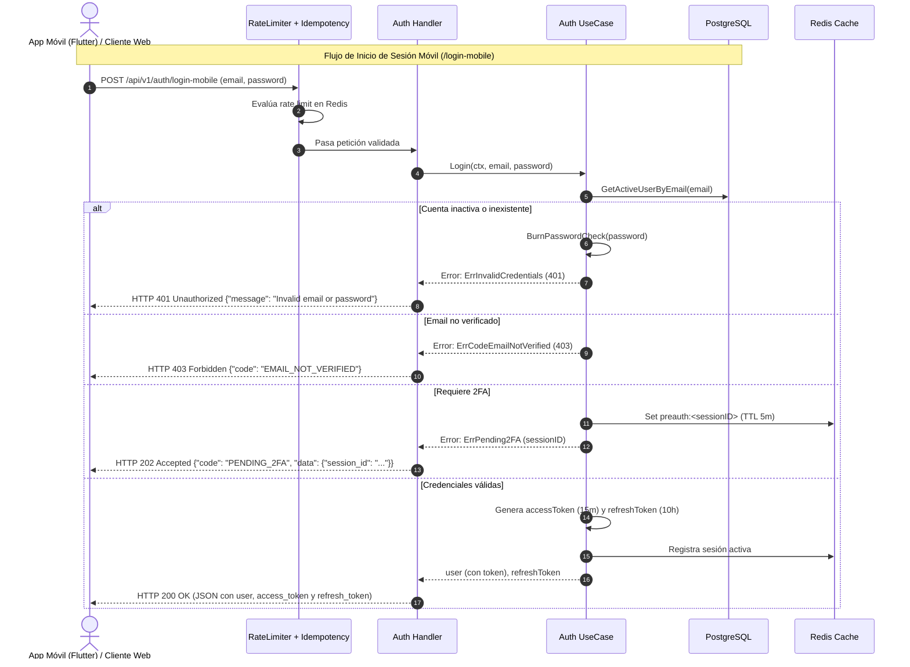

# 🔐 Feature: Autenticación y Cuentas (`features/auth`)
## path
`./internal/features/auth`

Documentación técnica y funcional del módulo de **Autenticación, Seguridad y Gestión de Cuentas (`Auth`)** en **Fitbase**.

---

## 1. Propósito y Alcance del Módulo

El módulo `auth` constituye el núcleo de seguridad, identidad y control de acceso de **Fitbase**. Es responsable de:
1. El registro público diferenciado de roles: Clientes (`RoleUserID = 1`) y Propietarios de Gimnasio (`RoleOwnerID = 2`).
2. El inicio de sesión seguro emitiendo tokens criptográficos **PASETO v2** para el acceso API y rotación de `refresh_token` en cookies seguras `HttpOnly` para clientes web.
3. El inicio de sesión y renovación de credenciales dedicado para **aplicaciones móviles** (`login-mobile` y `refresh-token-mobile`), entregando ambos tokens en el payload JSON sin dependencia de cookies y renovando el par mediante la cabecera `Authorization: Bearer <refresh_token>`.
4. El soporte para autenticación de dos factores (**2FA / TOTP**).
5. La verificación y activación de cuentas por correo electrónico mediante tokens temporales vinculados en Redis.
6. Los flujos de restablecimiento de contraseña por correo y actualización voluntaria con hash seguro `bcrypt` y protección contra ataques de temporización.
7. La protección perimetral mediante limitadores de tasa dedicados (`RateLimiterRedis`) para prevenir ataques de fuerza bruta y bombardeo de correos transaccionales.
8. El control de sesión activa y cierre de sesión unificado (`logout` y `logout-mobile`) con almacenamiento y validación activa de ambos tokens (`access_token` y `refresh_token`) en la sesión de Redis (`session:<sessionID>`), verificación en `AuthMiddleware`, y revocación total al hacer logout eliminando la sesión y registrando blacklist.

---

## 2. ¿Qué se implementó?

### 2.1. Entidades y DTOs (`internal/features/auth/domain.go` y `handler.go`)

- **Modelo de Identidad (`models.Auth`)**:
  - `id` (uint64): Identificador único de la cuenta.
  - `role_id` (uint64): 1 (`User`), 2 (`Owner`), 3 (`GymManager`), 4 (`Admin`).
  - `email` (string): Correo electrónico único normalizado.
  - `password_hash` (string, `json:"-"`): Hash seguro generado con `bcrypt`.
  - `two_factor_secret` (string, `json:"-"`): Llave secreta TOTP en Base32.
  - `two_factor_enabled` (bool): Bandera indicando si el 2FA está activo.
  - `first_session` (bool): Bandera indicando si es el primer inicio de sesión.
  - `full_profile` (bool): Bandera que indica si el actor ya completó sus datos de perfil personal o comercial.
  - `email_confirmed` (bool): Bandera que confirma la titularidad del correo.
  - `active` (bool): Estado activo/inactivo de la cuenta.
  - `token` (string, `json:"token"`): Token de acceso PASETO inyectado en tiempo de respuesta durante el login.
  - `created_at`, `updated_at` (time.Time): Marcas de tiempo de auditoría.
- **DTOs de Dominio**:
  - `UserBasic`: Proyección ligera para consultas rápidas (`id`, `email`).
- **DTOs de Entrada (`Request` en `handler.go`)**:
  - `RegisterRequest`: `email` (requerido, formato email), `password` (requerido, mín. 6 caracteres).
  - `LoginRequest`: `email` (requerido, formato email), `password` (requerido) — utilizado tanto en `Login` como en `LoginMobile`.
  - `ForwardEmailRequest`: `email` (requerido, formato email) para reenvío de correo de activación.
  - `VerifyEmailRequest`: `email` (requerido, formato email) para verificación de existencia de cuenta.
  - `SendPasswordResetRequest`: `email` (requerido, formato email) para solicitud de olvido de contraseña.
  - `ResetPasswordRequest`: `new_password` (requerido, mín. 6 caracteres).
  - `UpdatePasswordRequest`: `current_password` (requerido), `new_password` (requerido, mín. 6 caracteres).
  - `Verify2FARequest`: `code` (requerido, código TOTP).
- **Constructores de Dominio**:
  - `NewUser(email, password string) (*models.Auth, error)`: Crea usuario cliente con `RoleID = 1`, `FullProfile = false`.
  - `NewOwner(email, password string) (*models.Auth, error)`: Crea dueño de gimnasio con `RoleID = 2`, `FullProfile = false`.
  - `NewUserAdmin(email, password string) (*models.Auth, error)`: Crea administrador con `RoleID = 4`, `FullProfile = true`.

### 2.2. Casos de Uso (`internal/features/auth/usecase.go`)

- `Register(ctx, email, password)`: Registra un cliente (`RoleID = 1`), genera token de confirmación en Redis (`confirm:<userID>`) por 24 horas y despacha el correo transaccional de activación.
- `RegisterOwner(ctx, email, password)`: Registra un dueño (`RoleID = 2`), genera token de confirmación en Redis y despacha correo de activación.
- `Login(ctx, email, password)`:
  - Valida credenciales contra `bcrypt`. En caso de cuentas inactivas o inexistentes, ejecuta una comparación simulada (`utils.BurnPasswordCheck`) para neutralizar ataques de canal lateral / temporización.
  - Valida que `email_confirmed == true` (si no, retorna `ErrCodeEmailNotVerified`).
  - Si `two_factor_enabled == true`, crea sesión temporal `preauth:<sessionID>` en Redis con `platform: "web"` (TTL 5 min) y retorna `ErrPending2FA`.
  - Si el login es exitoso, emite `accessToken` (15 min) y `refreshToken` (10 horas) con `platform: "web"` en formato PASETO v2, y registra la sesión activa en Redis bajo `session:<sessionID>` y `user_session:web:<userID>` conteniendo explícitamente ambos tokens (`access_token` y `refresh_token`) con TTL de 10 horas.
- `LoginMobile(ctx, email, password)`:
  - Idéntico a `Login`, pero emite tokens con claim `platform: "mobile"` y registra la sesión bajo `user_session:mobile:<userID>`, permitiendo sesiones concurrentes independientes entre app móvil y web.
- `RefreshToken(ctx, token)`: Verifica el token de refresco (obtenido de la cookie `refresh_token` en web), comprueba la validez del usuario contra `user_session:web:<userID>`, emite un nuevo token PASETO de acceso por 15 minutos y actualiza la clave `access_token` en la sesión web de Redis.
- `RefreshTokenMobile(ctx, token)`: Variante para clientes móviles. Verifica el token recibido vía cabecera `Authorization: Bearer <refresh_token>` contra `user_session:mobile:<userID>`, emite un nuevo par de tokens (`access_token` de 15 min y `refresh_token` de 10 horas con `platform: "mobile"`) y renueva ambos tokens y el TTL en la sesión móvil de Redis.
- `GetSession(userID)`: Consulta la entidad `Auth` por `userID` asegurando que la cuenta permanezca activa y verificada.
- `ConfirmAccount(ctx, userID, token)`: Valida el token temporal almacenado en Redis bajo `confirm:<userID>`, marca `email_confirmed = true` en base de datos y purga la clave de Redis.
- `ForwardEmailVerification(ctx, email)`: Verifica que la cuenta exista y no esté confirmada, renueva el token temporal en Redis y reenruta el correo transaccional.
- `VerifyEmail(email)`: Comprueba si el correo electrónico ya existe registrado en la plataforma.
- `SendPasswordReset(ctx, email)`: Genera un token temporal (15 min), lo almacena en Redis bajo `reset:<userID>` y despacha correo de restablecimiento. Para prevenir enumeración de cuentas, responde exitosamente incluso si el correo no existe.
- `ResetPassword(userID, newPassword)`: Hashea la nueva contraseña con `bcrypt`, actualiza la fila en base de datos y purga la clave `reset:<userID>` de Redis.
- `UpdatePassword(userID, currentPassword, newPassword)`: Comprueba la contraseña actual del usuario autenticado antes de hashear y almacenar la nueva.
- `Logout(ctx, token)`:
  - Extrae el identificador del usuario y la plataforma (`web` o `mobile`) del token PASETO recibido.
  - Localiza y elimina únicamente la sesión de la plataforma correspondiente (`user_session:<platform>:<userID>` -> `session:<sessionID>`), evitando cerrar la sesión del otro dispositivo.
  - Extrae ambos tokens (`access_token` y `refresh_token`) de dicha sesión y los revoca en la lista negra (`blacklist:<token>`) con TTL exacto al tiempo restante de cada uno.
  - En el handler HTTP, también destruye y expira las cookies `refresh_token` y `pre_auth_session` del navegador si fue una petición web.
- `2FA (Verify2FALogin, EnableTWOFA, DisableTWOFA, VerifyTOTP)`: Generación de secret TOTP, generación de QR URI, validación de códigos y finalización de login con 2FA.

### 2.3. Repositorio (`internal/features/auth/repository.go`)

- `WithTransaction(fn func(repo *PostgresRepository) error) error`: Ejecutor transaccional con `*gorm.DB`.
- `Register(user *models.Auth) error`: Inserta una nueva entidad `Auth`.
- `GetByEmail(email string) (*models.Auth, error)`: Busca cuenta activa y con correo confirmado.
- `GetByEmailAny(email string) (*models.Auth, error)`: Busca cuenta sin filtrar por estado de confirmación.
- `GetActiveUserByEmail(ctx context.Context, email string) (*models.Auth, error)`: Busca cuenta para login verificando flags de `active` y `email_confirmed`.
- `GetByID(id uint64) (*models.Auth, error)`: Consulta usuario activo y verificado por ID.
- `GetBasicByID(id uint64)` y `GetBasicByEmail(email string)`: Proyecciones ligeras `UserBasic`.
- `ExistsByEmail(email string) (bool, error)`: Comprobación de existencia (`COUNT > 0`).
- `UpdateEmailConfirm(id uint64) error`: Actualiza `email_confirmed = true`.
- `UpdatePassword(id uint64, newPassword string) error`: Actualiza el hash de la contraseña.
- `SetTwoFactor(id uint64, enabled bool, secret string) error`: Actualiza estado y llave secreta 2FA.
- `ChangeStatus(id uint64, active bool) error`: Activa o desactiva la cuenta.
- `DeleteByID(id uint64) error`: Eliminación de cuenta.
- `UpdateEmail(id uint64, email string) error`: Modifica el correo y resetea `email_confirmed = false`.

### 2.4. Endpoints HTTP y Controladores

Todos los endpoints se encuentran montados bajo el prefijo `/api/v1/auth`:

| Método | Ruta | Middleware | Handler | Descripción |
| :--- | :--- | :--- | :--- | :--- |
| `POST` | `/api/v1/auth/login` | `Strict RateLimit (10/min)`, `Idempotency` | `Login` | Inicio de sesión web (setea cookie `refresh_token`) |
| `POST` | `/api/v1/auth/login-mobile` | `Strict RateLimit (10/min)`, `Idempotency` | `LoginMobile` | Inicio de sesión móvil (retorna `access_token` y `refresh_token` en body JSON) |
| `POST` | `/api/v1/auth/register` | `Strict RateLimit (10/min)`, `Idempotency` | `Register` | Registro público de usuario cliente (`RoleID = 1`) |
| `POST` | `/api/v1/auth/register-owner` | `Strict RateLimit (10/min)`, `Idempotency` | `RegisterOwner` | Registro público de dueño de gimnasio (`RoleID = 2`) |
| `POST` | `/api/v1/auth/forward-email-verification` | `Strict RateLimit (10/min)`, `Idempotency` | `ForwardEmailVerification` | Reenvío de correo de activación de cuenta |
| `POST` | `/api/v1/auth/forgot-password` | `Strict RateLimit (10/min)`, `Idempotency` | `SendPasswordReset` | Solicitud de restablecimiento de contraseña |
| `POST` | `/api/v1/auth/refresh-token` | `Idempotency` | `RefreshToken` | Renovación de token de acceso web (valida cookie `refresh_token` en Redis) |
| `POST` | `/api/v1/auth/refresh-token-mobile` | `Idempotency` | `RefreshTokenMobile` | Renovación móvil (valida cabecera `Authorization: Bearer <refresh_token>` en Redis) |
| `POST` | `/api/v1/auth/logout` | `Idempotency` | `Logout` | Cierre de sesión unificado (Web y Móvil): revoca sesión en Redis, pone token en blacklist y limpia cookies |
| `POST` | `/api/v1/auth/logout-mobile` | `Idempotency` | `Logout` | Alias directo de cierre de sesión para clientes móviles |
| `GET` | `/api/v1/auth/confirm-account` | `Auth`, `Idempotency` | `ConfirmAccount` | Confirmación de cuenta mediante token PASETO de correo |
| `GET` | `/api/v1/auth/session` | `Auth`, `Idempotency` | `GetSession` | Consulta de la sesión activa del usuario autenticado |
| `POST` | `/api/v1/auth/verify-email` | `Auth`, `Idempotency` | `VerifyEmail` | Comprobación de existencia de un correo registrado |
| `PATCH` | `/api/v1/auth/reset-password` | `Auth`, `Idempotency` | `ResetPassword` | Restablecimiento de contraseña con token temporal |
| `PATCH` | `/api/v1/auth/change-password` | `Auth`, `Idempotency` | `UpdatePassword` | Cambio voluntario de contraseña del usuario autenticado |

---

## 3. ¿Por qué se tomaron estas decisiones técnicas? (ADR)

### 3.1. Separación de Rutas de Registro (`/register` vs `/register-owner`)
- **Decisión**: Se implementaron dos rutas de registro diferenciadas en lugar de recibir un parámetro `role_id` en el cuerpo del JSON.
- **Justificación**: Elimina la vulnerabilidad de asignación masiva de privilegios (Mass Assignment). El cliente no puede elevar sus propios privilegios a administrador o dueño.

### 3.2. Cookies `HttpOnly` para Web vs Tokens en Payload para Móviles
- **Decisión**: Los clientes web almacenan el `refresh_token` en cookies `HttpOnly`, `SameSite=Lax` y `Secure`. Los clientes móviles disponen de `/login-mobile` y `/refresh-token-mobile` para recibir y renovar ambos tokens en el cuerpo JSON.
- **Justificación**: Los navegadores web se benefician de la protección nativa contra XSS mediante cookies `HttpOnly`. Las plataformas móviles (Flutter / iOS / Android) no ejecutan un motor de cookies de navegador de forma natural, pero disponen de almacenamiento seguro nativo (`KeyStore` / `Keychain`).

### 3.3. Tokens Criptográficos PASETO v2
- **Decisión**: Se eligió **PASETO (Platform-Agnostic Security Tokens) v2** sobre JWT tradicional.
- **Justificación**: PASETO elimina vulnerabilidades conocidas de JWT como el ataque de algoritmo `none` o la confusión entre claves simétricas y asimétricas, garantizando cifrado y firma robustos por defecto.

### 3.4. Limitador de Tasa Estricto por IP y Redis
- **Decisión**: Rutas de autenticación sensibles (`login`, `login-mobile`, `register`, `register-owner`, `forgot-password`, `forward-email-verification`) aplican un límite estricto de 10 peticiones por minuto con ráfaga de 5 mediante `RateLimiterRedis`.
- **Justificación**: Previene ataques de fuerza bruta, relleno de credenciales (*credential stuffing*) y denegación de servicio por bombardeo de correos electrónicos transaccionales.

### 3.5. Protección contra Timing Attacks en Login (`utils.BurnPasswordCheck`)
- **Decisión**: Si un correo no existe o se encuentra inactivo, el backend ejecuta un hash dummy `utils.BurnPasswordCheck(password)`.
- **Justificación**: Asegura que el tiempo de respuesta sea estadísticamente idéntico si el usuario existe o no, impidiendo que atacantes descubran qué correos están registrados midiendo la latencia de la respuesta.

### 3.6. Control de Sesión Activa, Almacenamiento Dual y Aislamiento por Plataforma en Redis
- **Decisión**:
  1. **Aislamiento por Plataforma**: Los tokens PASETO portan el claim de plataforma (`platform: "web"` o `platform: "mobile"`). En Redis, el puntero a la sesión se indexa con prefijo de plataforma: `user_session:web:<userID>` y `user_session:mobile:<userID>`. Esto garantiza que un usuario pueda tener sesiones activas simultáneas en su aplicación móvil y en la web sin que una sobreescriba o cierre a la otra.
  2. **Almacenamiento en Login**: Al autenticarse un usuario (`/login` para web o `/login-mobile` para móvil), la sesión en Redis (`session:<sessionID>`) almacena explícitamente tanto el `access_token` (corta duración, 15 min) como el `refresh_token` (larga duración, 10 horas) asociados a su respectivo `user_session:<platform>:<userID>`.
  3. **Validación en Middleware (`AuthMiddleware`)**: En cada petición normal entrante, tras verificar la firma criptográfica PASETO, el middleware consulta Redis en el prefijo correspondiente (`user_session:<platform>:<userID>`) para verificar que exista una sesión activa y que el token enviado coincida estrictamente con el `access_token` (corta duración, 15 min). No se permite el uso del `refresh_token` para peticiones generales. Por su parte, `StorageAuthMiddleware` acepta tanto `access_token` como `refresh_token` para compatibilidad de carga de archivos en navegadores. (Permite también tokens de un solo uso como `confirm:<userID>` y `reset:<userID>`).
  4. **Rotación y Validación Estricta en Refresh**: Al renovar tokens (`/refresh-token` o `/refresh-token-mobile`), el caso de uso valida explícitamente contra la sesión de dicha plataforma en Redis que el token recibido coincida con el `refresh_token` (larga duración, 10 horas), rechazando cualquier intento de usar un `access_token` para refrescar. Tras validarse, se generan los nuevos tokens con su respectiva plataforma y se actualiza la sesión en Redis.
  5. **Cierre de Sesión Granular**: Al invocar `Logout` (móvil o web), el backend extrae la plataforma del token y elimina únicamente la sesión de esa plataforma (`user_session:<platform>:<userID>`), preservando la sesión del otro dispositivo. En eventos globales de seguridad (como cambio o restablecimiento de contraseña), se purgan todas las plataformas simultáneamente.
- **Justificación**: Provee una arquitectura de seguridad híbrida (*stateless* criptográfica + *stateful* en memoria). Impide la reutilización de tokens huérfanos o viejos, evita que cerrar sesión en el teléfono cierre la sesión en el navegador (o viceversa) y mantiene un control exhaustivo del ciclo de vida de los tokens.

---

## 4. Flujo de Interacción



---

## 5. Contratos de API

### 5.1. Registro de Usuario Cliente
- **Ruta**: `POST /api/v1/auth/register`
- **Autenticación**: Pública
- **Rate Limit**: Estricto (10 req/min, ráfaga 5)
- **Request Body**:
```json
{
  "email": "usuario@fitbase.io",
  "password": "PasswordSegura123!"
}
```
- **Respuesta Exitosa (201 Created)**:
```json
{
  "message": "Usuario registrado exitosamente por favor verifica tu correo para activar tu cuenta"
}
```
- **Respuesta de Error de Validación (400 Bad Request)**:
```json
{
  "code": "VALIDATION_ERROR",
  "message": "Datos inválidos",
  "errors": [
    "El campo email debe ser un correo válido",
    "El campo password debe tener al menos 6 caracteres"
  ]
}
```

---

### 5.2. Registro de Dueño de Gimnasio
- **Ruta**: `POST /api/v1/auth/register-owner`
- **Autenticación**: Pública
- **Rate Limit**: Estricto (10 req/min, ráfaga 5)
- **Request Body**:
```json
{
  "email": "dueno@fitbase.io",
  "password": "PasswordSegura123!"
}
```
- **Respuesta Exitosa (201 Created)**:
```json
{
  "message": "Dueño registrado exitosamente por favor verifica tu correo para activar tu cuenta"
}
```

---

### 5.3. Inicio de Sesión Web (`Login`)
- **Ruta**: `POST /api/v1/auth/login`
- **Autenticación**: Pública
- **Rate Limit**: Estricto (10 req/min, ráfaga 5)
- **Request Body**:
```json
{
  "email": "usuario@fitbase.io",
  "password": "PasswordSegura123!"
}
```
- **Respuesta Exitosa (200 OK)**:
  - *Establece cabecera `Set-Cookie: refresh_token=<token>; HttpOnly; SameSite=Lax; Max-Age=28800; Path=/`*
```json
{
  "message": "Login successful",
  "data": {
    "id": 15,
    "role_id": 1,
    "email": "usuario@fitbase.io",
    "two_factor_enabled": false,
    "first_session": true,
    "full_profile": true,
    "email_confirmed": true,
    "active": true,
    "token": "v2.local.eyJzdWIiOiIxNSIsImV4cCI6IjIwMjYtMTAtMTNUMDI6MDA6MDBaIn0...",
    "created_at": "2026-10-13T01:45:00Z",
    "updated_at": "2026-10-13T01:45:00Z"
  }
}
```
- **Respuesta cuando requiere 2FA (202 Accepted)**:
  - *Establece cabecera `Set-Cookie: pre_auth_session=<session_id>; HttpOnly; SameSite=Lax; Max-Age=300; Path=/`*
```json
{
  "message": "Se requiere verificación de dos factores",
  "code": "PENDING_2FA"
}
```

---

### 5.4. Inicio de Sesión Móvil (`LoginMobile`)
- **Ruta**: `POST /api/v1/auth/login-mobile`
- **Autenticación**: Pública
- **Rate Limit**: Estricto (10 req/min, ráfaga 5)
- **Descripción**: Diseñado específicamente para aplicaciones móviles (Flutter / React Native / nativo). No utiliza ni requiere cookies. Retorna el usuario autenticado junto con el token de acceso de corta duración (`access_token`, 15 min) y el token de refresco de larga duración (`refresh_token`, 10 horas) en el objeto `data`.
- **Request Body**:
```json
{
  "email": "movil@fitbase.io",
  "password": "PasswordSegura123!"
}
```
- **Respuesta Exitosa (200 OK)**:
```json
{
  "message": "Login successful",
  "data": {
    "user": {
      "id": 15,
      "role_id": 1,
      "email": "movil@fitbase.io",
      "two_factor_enabled": false,
      "first_session": false,
      "full_profile": true,
      "email_confirmed": true,
      "active": true,
      "token": "v2.local.eyJzdWIiOiIxNSIsImV4cCI6IjIwMjYtMTAtMTNUMDI6MTU6MDBaIn0...",
      "created_at": "2026-10-13T01:45:00Z",
      "updated_at": "2026-10-13T01:45:00Z"
    },
    "access_token": "v2.local.eyJzdWIiOiIxNSIsImV4cCI6IjIwMjYtMTAtMTNUMDI6MTU6MDBaIn0...",
    "refresh_token": "v2.local.eyJzdWIiOiIxNSIsImV4cCI6IjIwMjYtMTAtMTNUMTI6MDA6MDBaIn0...",
    "token": "v2.local.eyJzdWIiOiIxNSIsImV4cCI6IjIwMjYtMTAtMTNUMDI6MTU6MDBaIn0..."
  }
}
```
- **Respuesta cuando requiere 2FA (202 Accepted)**:
```json
{
  "message": "Se requiere verificación de dos factores",
  "code": "PENDING_2FA",
  "data": {
    "session_id": "c8b417c8-3868-45d2-a5ec-080512837fae"
  }
}
```

---

### 5.5. Reenvío de Correo de Activación
- **Ruta**: `POST /api/v1/auth/forward-email-verification`
- **Autenticación**: Pública
- **Rate Limit**: Estricto (10 req/min, ráfaga 5)
- **Request Body**:
```json
{
  "email": "usuario@fitbase.io"
}
```
- **Respuesta Exitosa (200 OK)**:
```json
{
  "message": "Verification email forwarded successfully"
}
```

---

### 5.6. Solicitud de Olvido de Contraseña
- **Ruta**: `POST /api/v1/auth/forgot-password`
- **Autenticación**: Pública
- **Rate Limit**: Estricto (10 req/min, ráfaga 5)
- **Request Body**:
```json
{
  "email": "usuario@fitbase.io"
}
```
- **Respuesta Exitosa (200 OK)**:
```json
{
  "message": "Se ha enviado un correo para restablecer tu contraseña, por favor revisa tu bandeja de entrada"
}
```

---

### 5.7. Renovación de Token de Acceso Web (`Refresh Token`)
- **Ruta**: `POST /api/v1/auth/refresh-token`
- **Autenticación**: Cookie `refresh_token`
- **Headers**: Enviar cookies del navegador automáticamente (`credentials: include`).
- **Respuesta Exitosa (200 OK)**:
```json
{
  "message": "Token refreshed successfully",
  "data": {
    "token": "v2.local.eyJzdWIiOiIxNSIsImV4cCI6IjIwMjYtMTAtMTNUMDI6MDA6MDBaIn0..."
  }
}
```
- **Respuesta si falta la cookie (400 Bad Request)**:
```json
{
  "message": "No refresh token provided"
}
```

---

### 5.8. Renovación de Tokens para Aplicaciones Móviles (`RefreshTokenMobile`)
- **Ruta**: `POST /api/v1/auth/refresh-token-mobile`
- **Autenticación**: `Bearer <refresh_token>` en la cabecera `Authorization`
- **Headers Requeridos**:
  - `Authorization`: `Bearer <token_de_refresco>`
- **Descripción**: Permite a la app móvil renovar sus credenciales enviando el `refresh_token` previamente guardado en el almacenamiento seguro del dispositivo. Retorna un nuevo `access_token` de 15 minutos y un `refresh_token` rotado de 10 horas.
- **Respuesta Exitosa (200 OK)**:
```json
{
  "message": "Token refreshed successfully",
  "data": {
    "token": "v2.local.eyJzdWIiOiIxNSIsImV4cCI6IjIwMjYtMTAtMTNUMDI6MTU6MDBaIn0...",
    "access_token": "v2.local.eyJzdWIiOiIxNSIsImV4cCI6IjIwMjYtMTAtMTNUMDI6MTU6MDBaIn0...",
    "refresh_token": "v2.local.eyJzdWIiOiIxNSIsImV4cCI6IjIwMjYtMTAtMTNUMTI6MDA6MDBaIn0..."
  }
}
```
- **Respuesta si el token es inválido o expiró (401 Unauthorized)**:
```json
{
  "message": "No autorizado"
}
```

---

### 5.9. Cierre de Sesión (`Logout` y `LogoutMobile`)
- **Rutas**:
  - `POST /api/v1/auth/logout` (Unificado: Web y Móvil)
  - `POST /api/v1/auth/logout-mobile` (Alias directo para clientes móviles)
- **Autenticación**:
  - **Móvil / API**: Cabecera `Authorization: Bearer <access_token>`
  - **Web**: Cookie `refresh_token` o cabecera `Authorization`
- **Descripción**:
  1. Extrae el token PASETO de la cabecera `Authorization: Bearer <token>` o de la cookie `refresh_token`.
  2. Localiza la sesión activa del usuario (`user_session:<userID>` -> `session:<sessionID>`).
  3. Extrae ambos tokens (`access_token` y `refresh_token`) guardados en el hash de la sesión y los revoca en la lista negra (`blacklist:<token>`) según su TTL restante.
  4. Elimina la sesión activa de Redis (`session:<sessionID>` y `user_session:<userID>`), purgando simultáneamente ambos tokens de la memoria de Redis.
  5. Para clientes web, invalida y expira las cookies `refresh_token` y `pre_auth_session` (`MaxAge: -1`).
- **Respuesta Exitosa (200 OK)**:
```json
{
  "message": "Sesión cerrada exitosamente"
}
```
- **Respuesta si no se suministra token (400 Bad Request)**:
```json
{
  "message": "no token provided"
}
```

---

### 5.10. Confirmación de Cuenta de Correo
- **Ruta**: `GET /api/v1/auth/confirm-account`
- **Autenticación**: `Bearer <token_paseto_de_correo>`
- **Headers Requeridos**:
  - `Authorization`: `Bearer <token_confirmacion>`
- **Respuesta Exitosa (200 OK)**:
```json
{
  "message": "Tu cuenta ha sido confirmada exitosamente, ya puedes iniciar sesión"
}
```
- **Respuesta si el token es inválido o expiró (400 Bad Request)**:
```json
{
  "message": "Token inválido o expirado"
}
```

---

### 5.11. Consulta de Sesión Activa
- **Ruta**: `GET /api/v1/auth/session`
- **Autenticación**: `Bearer <token_paseto>`
- **Respuesta Exitosa (200 OK)**:
```json
{
  "message": "Session retrieved successfully",
  "data": {
    "id": 15,
    "role_id": 1,
    "email": "usuario@fitbase.io",
    "two_factor_enabled": false,
    "first_session": false,
    "full_profile": true,
    "email_confirmed": true,
    "active": true,
    "created_at": "2026-10-13T01:45:00Z",
    "updated_at": "2026-10-13T01:45:00Z"
  }
}
```

---

### 5.12. Verificación de Existencia de Correo
- **Ruta**: `POST /api/v1/auth/verify-email`
- **Autenticación**: `Bearer <token_paseto>`
- **Request Body**:
```json
{
  "email": "comprobar@fitbase.io"
}
```
- **Respuesta Exitosa si existe (200 OK)**:
```json
{
  "message": "Verification email sent successfully",
  "data": {
    "exist": true
  }
}
```
- **Respuesta si no existe (404 Not Found)**:
```json
{
  "message": "No se encontró el correo electrónico"
}
```

---

### 5.13. Restablecimiento de Contraseña
- **Ruta**: `PATCH /api/v1/auth/reset-password`
- **Autenticación**: `Bearer <token_paseto_de_reseteo>`
- **Headers Requeridos**:
  - `Authorization`: `Bearer <token_reseteo>`
- **Request Body**:
```json
{
  "new_password": "NuevaPasswordSegura2026!"
}
```
- **Respuesta Exitosa (200 OK)**:
```json
{
  "message": "Tu contraseña ha sido restablecida exitosamente, ya puedes iniciar sesión con tu nueva contraseña"
}
```

---

### 5.14. Cambio Voluntario de Contraseña
- **Ruta**: `PATCH /api/v1/auth/change-password`
- **Autenticación**: `Bearer <token_paseto>`
- **Request Body**:
```json
{
  "current_password": "PasswordActual123!",
  "new_password": "NuevaPasswordSegura2026!"
}
```
- **Respuesta Exitosa (200 OK)**:
```json
{
  "message": "Tu contraseña ha sido actualizada exitosamente, ya puedes iniciar sesión con tu nueva contraseña"
}
```
- **Respuesta de Error si la contraseña actual no coincide (400 Bad Request)**:
```json
{
  "message": "la contraseña actual es incorrecta"
}
```
