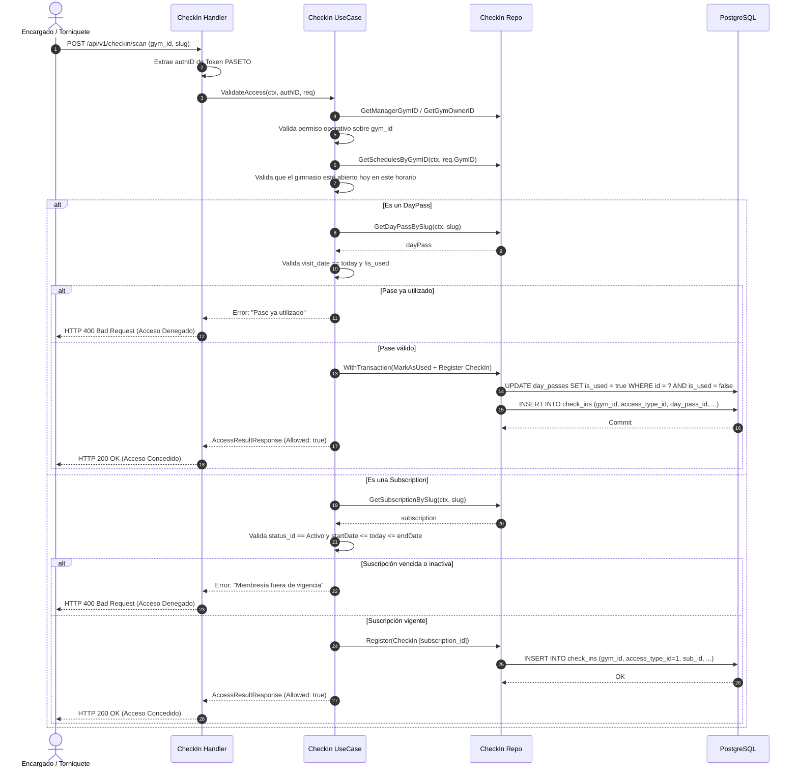

# 🚪 Feature: Control de Acceso y Entradas (`features/checkin`)

Documentación técnica y funcional del módulo de **Control de Acceso y Entradas (`CheckIn`)** en **Fitbase**.

---

## 1. Propósito y Alcance del Módulo

El módulo `checkin` es el componente operativo central que valida y registra en tiempo real los accesos físicos a las instalaciones de una sede de gimnasio mediante **escaneo de código QR (`slug` en formato UUIDv7)** o mediante **búsqueda manual por correo electrónico (`email`)** del socio.

Soporta un algoritmo unificado de resolución para dos modalidades de ingreso:
1. **Pases Diarios (`DayPass`)**: Valida que la fecha programada sea la del día en curso (`visit_date == today`), que el gimnasio esté abierto dentro de su horario de atención, que el boleto **haya sido pagado** (`is_paid == true`, mediante verificación contra `payments`) y que el boleto no haya sido utilizado previamente (`is_used == false`). De forma atómica, valida y estampa `is_used = true` para impedir cualquier reingreso con el mismo boleto.
2. **Membresías / Suscripciones (`Subscription`)**: Valida que la suscripción pertenezca a la sucursal, no se encuentre en estado `Pendiente` o `Expirado`, y que la fecha de hoy esté comprendida en el intervalo de vigencia `[start_date, end_date]`. Al ser membresía, permite ingresos ilimitados durante el periodo contratado (incluso si la membresía fue cancelada para futuras renovaciones pero aún cuenta con días restantes pagados).

Además, el módulo proporciona:
- **Autoconsulta de visitas del cliente (`GET /api/v1/checkin/my-history`)**: Historial cronológico con nombre de la sede y tipo de acceso.
- **Bitácora de torniquete/mostrador (`GET /api/v1/gyms/:id/checkins`)**: Auditoría operativa para Dueños y Encargados con rango de fechas (`?from=YYYY-MM-DD&to=YYYY-MM-DD`) y paginación.

---

## 2. ¿Qué se implementó?

### 2.1. Entidades y DTOs (`internal/features/checkin/domain.go`)

- **DTOs de Entrada (`Request`)**:
  - `ValidateAccessRequest`: Payload enviado por el escáner, torniquete o mostrador (`gym_id`, opcionalmente `slug` o `email`).
- **DTOs de Salida (`Response`)**:
  - `AccessResultResponse`: Veredicto en tiempo real (`allowed`, `message`, `access_type`, `full_name`, `plan_name`, `checked_in_at`).
  - `CheckInSummaryItem`: Detalle consolidado para historiales (`id`, `gym_id`, `gym_name`, `access_type_id`, `access_type_name`, `user_id`, `user_full_name`, `day_pass_id`, `subscription_id`, `registered_by_id`, `registered_by_name`, `checked_in_at`).
  - `PaginatedCheckInSummary`: Wrapper de paginación estándar.
- **Constructor**:
  - `NewCheckIn(gymID, accessTypeID uint64, userID, dayPassID, subID, registeredByID *uint64) (*models.CheckIn, error)`: Construye el registro con la estampa de tiempo actual.

### 2.2. Casos de Uso (`internal/features/checkin/usecase.go`)

- `ValidateAccess(...)`:
  - Valida que el operador autenticado tenga permisos sobre la sede (`GymManager` o `Owner`).
  - Comprueba que el gimnasio se encuentre abierto hoy y dentro de los minutos de servicio (`OpenMinutes <= currentMinutes < CloseMinutes`).
  - Valida que se haya proporcionado al menos un identificador (`slug` o `email`).
  - **Búsqueda por `slug` (QR)**: Parsea el UUID y busca primero en `day_passes` y luego en `subscriptions`.
  - **Búsqueda por `email` (Manual)**: Busca la suscripción más reciente del usuario para esa sede (`GetSubscriptionByEmail`), o un pase del día vigente (`GetDayPassByEmail`).
  - **Bifurcación DayPass**:
    - Si el pase existe, verifica concordancia de `gym_id` y `visit_date == today`.
    - Rechaza inmediatamente si `is_used == true` ("Pase ya utilizado").
    - Ejecuta transacción atómica: actualiza `is_used = true` y crea el registro en `check_ins` con tipo de acceso `Día de Pase` o `Invitado`.
  - **Bifurcación Subscription**:
    - Si la suscripción existe, verifica concordancia de `gym_id`, estado no revocado/expirado y vigencia `startDate <= today <= endDate`.
    - Inserta el registro en `check_ins` con tipo de acceso `Membresía`.
  - Si el identificador no coincide con ningún registro válido, retorna `ErrNotFound` ("Ticket o credencial no encontrada" o "No se encontró ninguna membresía o pase para el correo especificado en esta sede").
- `GetMyHistory(...)`: Resuelve el `userID` del cliente en sesión y retorna su bitácora paginada.
- `GetAllByGym(...)`: Lista los accesos de la sede para el Dueño o Encargado autorizado, con filtros opcionales de fecha.

### 2.3. Repositorio (`internal/features/checkin/repository.go`)

- `WithTransaction(...)`: Ejecución segura bajo transacción de base de datos.
- `Register(ctx context.Context, checkIn *models.CheckIn) error`: Inserción en `check_ins`.
- `MarkDayPassAsUsed(ctx context.Context, id uint64) error`: Actualización atómica con condición `is_used = false`.
- `GetAllByGymID(...)` y `GetAllByUserID(...)`: Consultas optimizadas con Joins a `gyms`, `access_types`, `users`, `day_passes` y `auths`.
- Métodos auxiliares de verificación de sedes, horarios y perfiles de usuario.

### 2.4. Endpoints HTTP y Controladores

| Método | Ruta | Middleware | Descripción |
| :--- | :--- | :--- | :--- |
| `POST` | `/api/v1/checkin/scan` | `Auth`, `Idempotency` | Validación y registro de acceso físico por escaneo de QR |
| `GET` | `/api/v1/checkin/my-history` | `Auth`, `Idempotency` | Historial de visitas y entradas del socio logueado |
| `GET` | `/api/v1/gyms/:id/checkins` | `Auth`, `Idempotency` | Bitácora de accesos de la sede para Dueño y Encargado |

---

## 3. ¿Por qué se tomaron estas decisiones técnicas? (ADR)

### 3.1. Algoritmo de Acceso Dual (1 Uso vs Ilimitado)
- **Decisión**: El motor de validación distingue la semántica del acceso según la entidad origen del `Slug`:
  - `DayPass`: Admite exactamente **1 uso**. Una vez consumido, su estado cambia a `is_used = true` y cualquier escaneo posterior es denegado.
  - `Subscription`: Admite **ingresos ilimitados** mientras la suscripción esté activa y dentro del rango de vigencia `[start_date, end_date]`.
- **Justificación**: Representa fielmente las reglas de negocio del mundo real, diferenciando un boleto desechable de una membresía periódica.

### 3.2. Transacción Atómica contra Race Conditions en DayPass
- **Decisión**: La marcación `is_used = true` y la creación del registro en `check_ins` se ejecutan dentro de una transacción PostgreSQL con la cláusula `WHERE is_used = false`.
- **Justificación**: Previene el ataque de doble acceso simultáneo (*race condition*), donde dos torniquetes intenten escanear la misma captura de pantalla del QR al mismo milisegundo.

### 3.3. Control de Horario Físico de Sede (`GymSchedule`)
- **Decisión**: Antes de procesar el boleto, se evalúa si el gimnasio está abierto según el día de la semana (`dayOfWeek`) y la hora en minutos (`currentMinutes`).
- **Justificación**: Garantiza que ningún acceso sea concedido ni registrado fuera del horario legal de operación de las instalaciones o en días no laborables.

### 3.4. Auditoría Completa del Operador (`registered_by_id`)
- **Decisión**: En cada entrada registrada se almacena el `auth_id` del encargado o torniquete autenticado en la sesión.
- **Justificación**: Proporciona trazabilidad forense para auditar qué empleado o dispositivo dio paso al usuario físico.

---

## 4. Flujo de Interacción



---

## 5. Contratos de API

### 5.1. Validación de Acceso (QR o Correo Electrónico)
- **Ruta**: `POST /api/v1/checkin/scan`
- **Autenticación**: `Bearer <token_paseto>` (Encargado o Dueño)
- **Opción A: Validación por Código QR (`slug`)**:
```json
{
  "gym_id": 1,
  "slug": "0192663b-6f81-7994-b25c-05ec2c6c3981"
}
```
- **Opción B: Validación Manual por Correo (`email`)**:
```json
{
  "gym_id": 1,
  "email": "socio@fitbase.app"
}
```
- **Response `200 OK` (Acceso Concedido)**:
```json
{
  "message": "Acceso validado exitosamente",
  "data": {
    "allowed": true,
    "message": "Acceso concedido",
    "access_type": "Membresía",
    "full_name": "Moy Morales",
    "plan_name": "Plan Mensual Premium",
    "checked_in_at": "2026-10-13T02:15:30Z"
  }
}
```
- **Response `400 Bad Request` (Parámetros inválidos, pase utilizado o fuera de horario)**:
```json
{
  "message": "Debes ingresar el código QR (slug) o el correo electrónico del socio"
}
```
- **Response `404 Not Found` (Membresía o pase no encontrado para esa sede)**:
```json
{
  "message": "No se encontró ninguna membresía o pase para el correo especificado en esta sede"
}
```

---

### 5.2. Historial de Accesos del Cliente
- **Ruta**: `GET /api/v1/checkin/my-history?page=1&page_size=10`
- **Autenticación**: `Bearer <token_paseto>` (Cliente)
- **Parámetros Query**:
  - `page` (int, opcional, default: 1): Número de página.
  - `page_size` (int, opcional, default: 10): Tamaño de página.
- **Response `200 OK`**:
```json
{
  "data": {
    "data": [
      {
        "id": 101,
        "gym_id": 1,
        "gym_name": "Fitbase Central",
        "access_type_id": 1,
        "access_type_name": "Membresía",
        "user_id": 3,
        "user_full_name": "Moy Morales",
        "day_pass_id": null,
        "subscription_id": 8,
        "registered_by_id": 2,
        "registered_by_name": "recepcion.central@fitbase.io",
        "checked_in_at": "2026-10-13T02:15:30Z"
      }
    ],
    "paginate": {
      "page": 1,
      "page_size": 10,
      "total": 1,
      "total_pages": 1
    }
  }
}
```

---

### 5.3. Bitácora de Accesos de la Sede
- **Ruta**: `GET /api/v1/gyms/:id/checkins?page=1&page_size=10&from=2026-10-01&to=2026-10-13`
- **Autenticación**: `Bearer <token_paseto>` (Dueño o Encargado)
- **Parámetros de Ruta**:
  - `:id` (uint64, requerido): Identificador de la sede.
- **Parámetros Query**:
  - `page` (int, opcional, default: 1): Número de página.
  - `page_size` (int, opcional, default: 10): Tamaño de página.
  - `from` (string, opcional): Fecha inicial en formato YYYY-MM-DD.
  - `to` (string, opcional): Fecha final en formato YYYY-MM-DD.
- **Response `200 OK`**:
```json
{
  "data": {
    "data": [
      {
        "id": 101,
        "gym_id": 1,
        "gym_name": "Fitbase Central",
        "access_type_id": 1,
        "access_type_name": "Membresía",
        "user_id": 3,
        "user_full_name": "Moy Morales",
        "day_pass_id": null,
        "subscription_id": 8,
        "registered_by_id": 2,
        "registered_by_name": "recepcion.central@fitbase.io",
        "checked_in_at": "2026-10-13T02:15:30Z"
      }
    ],
    "paginate": {
      "page": 1,
      "page_size": 10,
      "total": 1,
      "total_pages": 1
    }
  }
}
```
- **Response `403 Forbidden`**:
```json
{
  "message": "No tienes permiso para consultar los accesos de esta sede"
}
```

