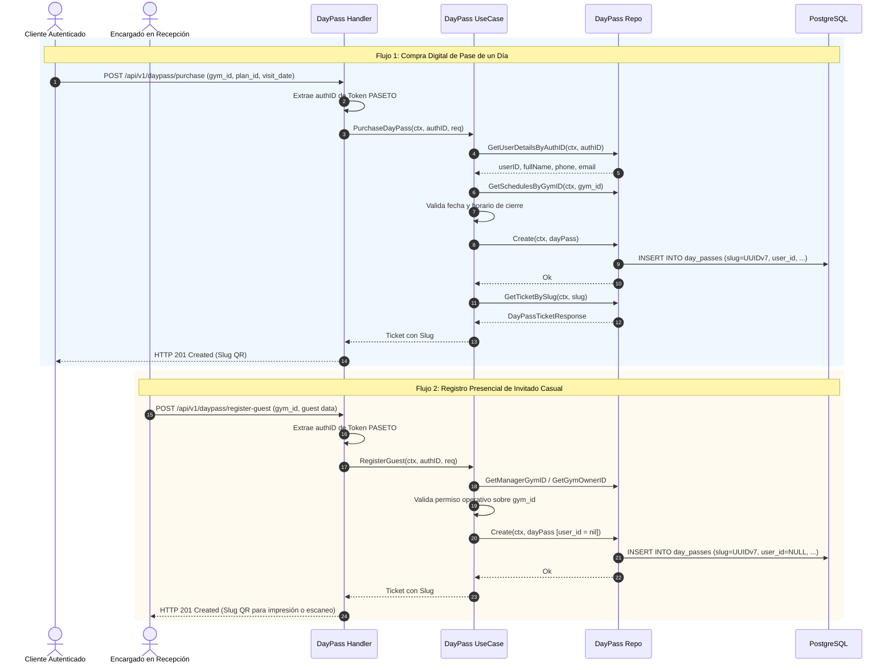

# 🎫 Feature: Pases de un Día / Visitas Únicas (`features/daypass`)

Documentación técnica y funcional del módulo de **Pases Diarios (`DayPass`)** en **Fitbase**.

---

## 1. Propósito y Alcance del Módulo

El módulo `daypass` gestiona el ciclo de vida de los pases de un solo día o visitas individuales a una sede de gimnasio determinada. Admite tres modalidades de emisión y dos canales de pago:
1. **Emisión pública por visitante sin cuenta (`POST /api/v1/daypass/guest`)**: Una persona que visita la plataforma pública (web/app en `/guest`) y no desea crearse una cuenta puede generar un pase diario con `UserID == nil` para pagarlo en mostrador o conservarlo digitalmente.
2. **Compra digital por usuario registrado (`POST /api/v1/daypass/purchase`)**: El cliente con cuenta adquiere un pase para sí mismo en una fecha específica (`visit_date`), asociando su `UserID` a la visita.
3. **Registro presencial en recepción por Encargado o Dueño (`POST /api/v1/daypass/register-guest`)**: El personal de mostrador registra a un visitante casual que llega directamente a las instalaciones sin cuenta ni reserva previa (`UserID == nil`), capturando nombre, teléfono y correo para trazabilidad y contacto.

Todos los flujos emiten un ticket con un identificador único seguro `Slug` (**UUIDv7**), el cual sirve para generar el código QR que se presentará en recepción o en el torniquete de acceso, e incluyen `plan_price` y `is_paid` para que el personal verifique el estado del cobro antes del ingreso.

---

## 2. ¿Qué se implementó?

### 2.1. Entidades y DTOs (`internal/features/daypass/domain.go`)

- **DTOs de Entrada (`Request`)**:
  - `CreateDayPassRequest`: Para usuarios registrados (`gym_id`, `plan_id`, `visit_date`).
  - `RegisterGuestRequest`: Para registro de invitado/público (`gym_id`, `plan_id`, `full_name`, `phone`, `email`, `visit_date` opcional).
- **DTOs de Salida (`Response`)**:
  - `DayPassTicketResponse`: Información del boleto digital / QR (`id`, `slug`, `gym_id`, `gym_name`, `plan_id`, `plan_name`, `plan_price`, `is_paid`, `full_name`, `phone`, `email`, `visit_date`, `is_used`, `created_at`).
  - `DayPassDetailResponse`: Detalle administrativo incluyendo `user_id` opcional, `plan_price` y `is_paid`.
  - `PaginatedDayPassSummary`: Envoltorio con listado paginado y metadata (`Page`, `PageSize`, `Total`, `TotalPages`).
- **Constructores**:
  - `NewDayPass(gymID, planID uint64, userID *uint64, fullName, phone, email string, visitDate time.Time) (*models.DayPass, error)`: Valida consistencia y sanitiza cadenas.

### 2.2. Casos de Uso (`internal/features/daypass/usecase.go`)

- `CreatePublicDayPass(...)`:
  - Permite a visitantes no autenticados en la web pública solicitar un pase de día.
  - Valida que la fecha de visita y horario sean válidos.
  - Valida que el plan exista, pertenezca a la sede, esté activo y sea de un solo uso (`duration <= 1` o `max_visits == 1`).
  - Crea el pase con `UserID = nil` y estado `is_used = false`.
- `PurchaseDayPass(...)`:
  - Extrae `authID` del token PASETO y obtiene perfil del usuario en `users` y `auths`.
  - Valida fecha, horario y que el plan sea de un solo uso.
  - Persiste el pase diario (`models.DayPass`) con `UserID` asignado.
- `RegisterGuest(...)`:
  - Valida que el usuario ejecutor sea el Encargado asignado a esa sede (`GymManager`) o el Dueño de la misma (`Owner`).
  - Valida que el gimnasio esté abierto hoy y dentro del horario de atención.
  - Valida que el plan seleccionado sea de un solo uso.
  - Crea el pase con `UserID = nil`.
- `GetTicketBySlug(...)`:
  - Endpoint público de consulta para validar el ticket a partir de su `slug` (UUIDv7).
- `GetAllByGym(...)`:
  - Listado paginado de pases emitidos en una sede para el Dueño o Encargado autorizado, con filtro por fecha (`?date=YYYY-MM-DD`) y **buscador dinámico (`?search=` o `?query=`)** sobre nombre, email, teléfono o slug.

### 2.3. Repositorio (`internal/features/daypass/repository.go`)

- `Create(ctx context.Context, dayPass *models.DayPass) error`: Inserción en base de datos.
- `GetBySlug(ctx context.Context, slug uuid.UUID) (*models.DayPass, error)`: Búsqueda por slug.
- `GetTicketBySlug(ctx context.Context, slug uuid.UUID) (*DayPassTicketResponse, error)`: Consulta optimizada con `JOIN gyms`, `JOIN plans`, calculando `plan_price` y `is_paid` mediante subconsulta a `payments`.
- `MarkAsUsed(ctx context.Context, id uint64) error`: Actualiza `is_used = true` de forma atómica.
- `GetAllByGymID(ctx context.Context, gymID uint64, date time.Time, search string, offset, limit int) ([]DayPassDetailResponse, int64, error)`: Consulta paginada con filtros combinados de fecha y búsqueda textual.

### 2.4. Endpoints HTTP y Controladores

| Método | Ruta | Middleware | Descripción |
| :--- | :--- | :--- | :--- |
| `POST` | `/api/v1/daypass/guest` | `Idempotency` | **Público**: Generación de pase diario para visitantes sin cuenta que pagan en recepción |
| `POST` | `/api/v1/daypass/purchase` | `Auth`, `Idempotency` | Compra de pase diario por cliente autenticado con cuenta |
| `POST` | `/api/v1/daypass/register-guest` | `Auth`, `Idempotency` | Registro en recepción por Encargado o Dueño |
| `GET` | `/api/v1/daypass/:slug/ticket` | `Idempotency` | **Público**: Consulta del boleto digital y QR mediante su Slug |
| `GET` | `/api/v1/gyms/:id/daypasses` | `Auth`, `Idempotency` | Listado administrativo de pases por sede con buscador (`?search=`) y fecha |

### 2.5. Flujo Operativo Completo: Visitante Sin Cuenta y Recepción

#### 🟢 Escenario 1: Visitante que reserva en línea y paga en recepción
1. **El visitante entra a la versión pública** (landing `/guest`):
   - No desea crear una cuenta.
   - Selecciona el gimnasio, el plan de visita y completa sus datos (`full_name`, `phone`, `email`, `visit_date`).
   - Elige **"Pagar en Recepción"**: se invoca `POST /api/v1/daypass/guest`.
   - El sistema le devuelve su ticket con código QR / `slug`. El pase queda registrado con `is_paid: false`.
2. **Llega al gimnasio y se presenta con el Encargado**:
   - Dice su nombre, correo o muestra el código/slug de su pase.
3. **El Encargado busca el pase antes de cobrar**:
   - Consulta `GET /api/v1/gyms/:id/daypasses?search=carlos` (o buscando por su email / slug / teléfono).
   - O consulta `GET /api/v1/daypass/:slug/ticket`.
   - **Verificación**:
     - Confirma que el pase **existe**.
     - Revisa el monto a cobrar (`plan_price`).
     - Comprueba que `is_paid == false` y `is_used == false`.
4. **Cobro en Caja**:
   - El encargado registra el cobro vía `POST /api/v1/payments/cash` indicando el `day_pass_id`, `amount` y el método de pago (Efectivo `1` o Terminal POS `2`).
   - El pase queda marcado como pagado (`is_paid: true`).
5. **Acceso al Gimnasio**:
   - El encargado o el torniquete valida la entrada vía `POST /api/v1/checkin/access` con el slug o el email.
   - El sistema valida que el pase esté pagado y marca `is_used: true`.

#### 🔵 Escenario 2: Visitante que compra en línea y paga con tarjeta (Stripe)
1. **El visitante entra a la versión pública** (`/guest`):
   - Elige **"Pagar con Tarjeta"**.
   - Se invoca `POST /api/v1/payments/stripe/guest-checkout`.
   - Se redirige a Stripe Checkout donde ingresa su tarjeta.
2. **Confirmación automática**:
   - Al completarse el pago, el webhook de Stripe emite el pase con `user_id = nil` y marca el pago como completado (`is_paid: true`).
3. **Acceso directo**:
   - Llega a la sucursal y muestra su código QR o correo en recepción. Como ya está pagado, el check-in le da acceso inmediato sin pasar a pagar en caja.

#### 🟡 Escenario 3: Visitante espontáneo que llega directo a recepción
1. **Llega al mostrador sin nada previo**:
   - Pide un pase de un solo uso.
2. **Registro por el Encargado**:
   - El encargado registra sus datos en `POST /api/v1/daypass/register-guest`.
   - Se genera el pase en el sistema.
3. **Cobro inmediato**:
   - El encargado cobra el pase en efectivo o tarjeta física vía `POST /api/v1/payments/cash`.
4. **Acceso**:
   - Se realiza el check-in de acceso.

---

## 3. ¿Por qué se tomaron estas decisiones técnicas? (ADR)

### 3.1. `UserID` Opcional (`*uint64` / Nullable)
- **Decisión**: El campo `user_id` en la tabla `day_passes` es opcional (`nil` en Go).
- **Justificación**: En la dinámica diaria de un gimnasio, muchos visitantes asisten una sola vez como invitados o turistas. Obligarlos a descargar la aplicación o registrar una cuenta completa en la recepción provocaría fricción e inhibiría las ventas rápidas. Al permitir `UserID == nil`, el encargado puede registrar a la persona capturando solo sus datos básicos en segundos.

### 3.2. Identificador Seguro `Slug` con UUIDv7
- **Decisión**: Cada pase genera automáticamente en su hook `BeforeCreate` un `Slug` de tipo `uuid.UUID` versión 7.
- **Justificación**: 
  1. **Seguridad contra enumeración**: Un atacante no puede adivinar o iterar números enteros consecutivos para robar tickets de acceso.
  2. **Indexación optimizada**: Al ser UUIDv7 ordenado por timestamp, se preserva la localidad de caché del índice B-Tree en PostgreSQL a diferencia de UUIDv4 aleatorio.
  3. **QR Friendly**: El slug se incrusta limpiamente en el payload del código QR.

### 3.3. Validación Dinámica de Fechas y Horarios
- **Decisión**: La función `validateVisitDateAndSchedule` comprueba que no se compren pases en fechas pasadas, y si la fecha es hoy, verifica el horario de apertura/cierre (`GymSchedule`) del día de la semana correspondiente.
- **Justificación**: Previene reclamos y fraudes al evitar que un usuario adquiera un pase diario para una sucursal que ya ha cerrado sus puertas por el día o que no abre ese día en específico.

### 3.4. Prevención de IDOR y Verificación de Roles
- **Decisión**: Para compras digitales, el cliente no envía su ID de usuario en el payload; el sistema lo resuelve a través del token criptográfico PASETO. Para el registro presencial y consulta administrativa, se valida que el `authID` sea el encargado asignado a esa sucursal o el dueño de la misma.

---

## 4. Flujo de Interacción



---

## 5. Contratos de API

### 5.1. Compra de Pase Diario por Usuario Registrado
- **Ruta**: `POST /api/v1/daypass/purchase`
- **Autenticación**: `Bearer <token_paseto>`
- **Request Body**:
```json
{
  "gym_id": 1,
  "plan_id": 3,
  "visit_date": "2026-10-15"
}
```
- **Response `201 Created`**:
```json
{
  "message": "Pase de un día generado exitosamente",
  "data": {
    "id": 14,
    "slug": "0192663b-6f81-7994-b25c-05ec2c6c3981",
    "gym_id": 1,
    "gym_name": "Fitbase Central",
    "plan_id": 3,
    "plan_name": "Pase Diario Completo",
    "full_name": "Moy Morales",
    "phone": "+525511223344",
    "email": "moy@fitbase.io",
    "visit_date": "2026-10-15",
    "is_used": false,
    "created_at": "2026-10-13T01:50:00Z"
  }
}
```
- **Response `400 Bad Request`**:
```json
{
  "message": "el horario de atención del gimnasio ha concluido por hoy"
}
```

---

### 5.2. Registro de Invitado Ocasional en Recepción
- **Ruta**: `POST /api/v1/daypass/register-guest`
- **Autenticación**: `Bearer <token_paseto>` (Encargado o Dueño)
- **Request Body**:
```json
{
  "gym_id": 1,
  "plan_id": 3,
  "full_name": "Carlos Santillán",
  "phone": "+525544332211",
  "email": "carlos.guest@gmail.com",
  "visit_date": "2026-10-13"
}
```
- **Response `201 Created`**:
```json
{
  "message": "Invitado registrado exitosamente",
  "data": {
    "id": 15,
    "slug": "0192663b-7221-7da3-9f88-444455556666",
    "gym_id": 1,
    "gym_name": "Fitbase Central",
    "plan_id": 3,
    "plan_name": "Pase Diario Completo",
    "full_name": "Carlos Santillán",
    "phone": "+525544332211",
    "email": "carlos.guest@gmail.com",
    "visit_date": "2026-10-13",
    "is_used": false,
    "created_at": "2026-10-13T01:51:00Z"
  }
}
```
- **Response `403 Forbidden`**:
```json
{
  "message": "No tienes autorización para registrar visitas en esta sede"
}
```

---

### 5.3. Consulta de Ticket / QR por Slug
- **Ruta**: `GET /api/v1/daypass/:slug/ticket`
- **Autenticación**: Pública
- **Parámetros de URL**: `:slug` (UUIDv7)
- **Response `200 OK`**:
```json
{
  "data": {
    "id": 15,
    "slug": "0192663b-7221-7da3-9f88-444455556666",
    "gym_id": 1,
    "gym_name": "Fitbase Central",
    "plan_id": 3,
    "plan_name": "Pase Diario Completo",
    "full_name": "Carlos Santillán",
    "phone": "+525544332211",
    "email": "carlos.guest@gmail.com",
    "visit_date": "2026-10-13",
    "is_used": false,
    "created_at": "2026-10-13T01:51:00Z"
  }
}
```
- **Response `404 Not Found`**:
```json
{
  "message": "Ticket no encontrado"
}
```

---

### 5.4. Listado Administrativo de Pases por Sede
- **Ruta**: `GET /api/v1/gyms/:id/daypasses?page=1&page_size=10&date=2026-10-13`
- **Autenticación**: `Bearer <token_paseto>` (Dueño o Encargado)
- **Response `200 OK`**:
```json
{
  "data": {
    "data": [
      {
        "id": 15,
        "slug": "0192663b-7221-7da3-9f88-444455556666",
        "user_id": null,
        "gym_id": 1,
        "gym_name": "Fitbase Central",
        "plan_id": 3,
        "plan_name": "Pase Diario Completo",
        "full_name": "Carlos Santillán",
        "phone": "+525544332211",
        "email": "carlos.guest@gmail.com",
        "visit_date": "2026-10-13",
        "is_used": false,
        "created_at": "2026-10-13T01:51:00Z"
      }
    ],
    "paginate": {
      "page": 1,
      "page_size": 10,
      "total": 1,
      "total_pages": 1
    }
  }
}
```
