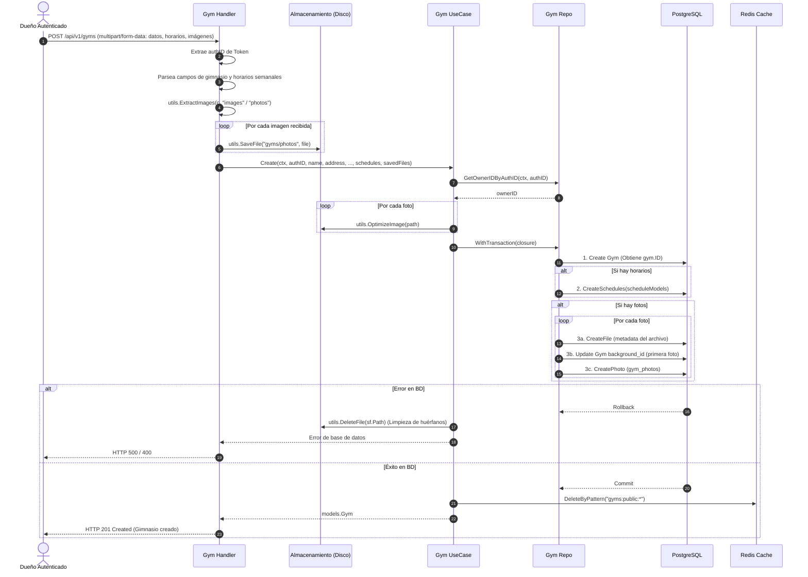

# 🏢 Feature: Gestión de Sedes, Horarios y Fotos (`features/gym`)

Documentación técnica y funcional del módulo de **Sedes de Gimnasio (`Gym`)**, **Horarios Semanales (`GymSchedule`)** y **Fotografías (`GymPhoto` / `File`)** en **Fitbase**.

---

## 1. Propósito y Alcance del Módulo

El módulo `gym` permite a los dueños de gimnasios (`Owner`) dar de alta y administrar sus sucursales físicas de manera completa e integral. El proceso de registro permite no solo capturar los datos generales y coordenadas geolocalizadas del gimnasio, sino también sus horarios de atención semanales y las fotografías de la sede en una sola operación atómica.

Posterior al registro, el módulo permite la administración continua de la sede:
- Modificación de datos generales y ubicación.
- Configuración masiva de horarios semanales o actualización puntual de un horario específico.
- Carga de nuevas fotografías (individuales o en lote) con optimización automática.
- Eliminación segura de fotografías tanto de la base de datos como del almacenamiento físico en disco, con reasignación inteligente de la foto de fondo (`background_id`).

Asimismo, expone consultas públicas optimizadas y cacheadas en Redis para que clientes y visitantes puedan explorar gimnasios, calcular distancias espaciales con PostGIS, conocer los horarios y verificar si la sede está abierta o cerrada en tiempo real.

---

## 2. ¿Qué se implementó?

### 2.1. Entidades y DTOs (`internal/features/gym/domain.go` y `internal/models/models.go`)

- **Modelos de Base de Datos**:
  - `Gym`: Representa la sede física (`id`, `owner_id`, `background_id`, `name`, `address`, `phone`, `email`, `latitude`, `longitude`, `location`). Posee relaciones con `Owner`, `Background (*File)`, `GymSchedules ([]GymSchedule)` y `GymPhotos ([]GymPhoto)`.
  - `GymSchedule`: Horarios semanales (`gym_id`, `day_of_week`, `open_minutes`, `close_minutes`, `is_closed`).
  - `GymPhoto`: Fotografía vinculada a la sede (`gym_id`, `file_id`).
  - `File`: Archivo subido en almacenamiento (`id`, `slug`, `path`, `mime_type`, `size`, `author_id`).
- **DTOs de Entrada (`Request`)**:
  - `CreateGymRequest`: Validación de nombre, dirección, teléfono, correo (con regex), latitud y longitud con tags `json` y `form`.
  - `UpdateGymRequest`: Actualizaciones parciales u opcionales de datos y coordenadas.
  - `GymScheduleItemRequest`: Estructura para configurar un día de horario (`day_of_week`, `open_minutes`, `close_minutes`, `is_closed`).
  - `SetScheduleRequest`: Colección de horarios por día para actualización masiva.
  - `UpdateGymScheduleRequest`: Actualización puntual de un horario (`day_of_week`, `open_minutes`, `close_minutes`, `is_closed`).
  - `SavedFile`: DTO interno para el traspaso de archivos subidos y persistidos temporalmente (`file_id`, `path`, `mime_type`, `size`).
- **DTOs de Salida (`Response`)**:
  - `GymPublicSummary`: Resumen público para catálogo y tarjetas (`id`, `name`, `address`, `phone`, `email`, `latitude`, `longitude`, `is_open`, `background_url`, `distance_meters`).
  - `GymDetailResponse`: Vista detallada de una sede con su colección agregada de horarios semanales, fotos (`id`, `url`) y bandera dinámica `is_open`.
  - `GymScheduleItem`: Item de horario semanal devuelto al cliente.
  - `PaginatedGymSummary`: Contenedor paginado con `data` y `paginate` (`models.Pagination`).
- **Constructores y Updaters**:
  - `New(ownerID uint64, name, address, phone, email string, lat, lng float64) (*models.Gym, error)`.
  - `BuildGymUpdateData(data *models.Gym) map[string]any`.
  - `BuildScheduleUpdateData(req UpdateGymScheduleRequest) map[string]any`.

### 2.2. Casos de Uso (`internal/features/gym/usecase.go`)

- `Create(...)`:
  1. Valida identidad del dueño a partir de `authID` (`GetOwnerIDByAuthID`).
  2. Valida datos y coordenadas del gimnasio mediante `New(...)`.
  3. Optimiza las fotografías con `utils.OptimizeImage` (conversión Lanczos a JPEG comprimido).
  4. Ejecuta una **transacción atómica** (`WithTransaction`):
     - Inserta el registro `Gym`.
     - Inserta en lote los 7 horarios `GymSchedule` (días 0 al 6). Si algún día no fue enviado por el usuario, se inicializa automáticamente como cerrado (`is_closed: true, open_minutes: 0, close_minutes: 0`).
     - Inserta los metadatos de archivo `File`, configura la primera foto como `background_id` y crea los registros `GymPhoto`.
  5. En caso de fallo transaccional, elimina automáticamente del disco los archivos temporales u optimizados (`utils.DeleteFile`).
  6. Invalida la caché pública en Redis (`DeleteByPattern("gyms:public:*")`).
- `Update(...)`: Valida pertenencia del staff (`IsGymStaff`: Dueño o Encargado asignado) para prevenir IDOR y aplica actualización con mapa. Invalida caché pública.
- `SetSchedules(...)`: Valida pertenencia del staff (`IsGymStaff`) y ejecuta una transacción atómica `WithTransaction` para aplicar upsert de los 7 días de la semana. Invalida caché pública.
- `UpdateSchedule(...)`: Valida pertenencia del staff (`IsGymStaff`) y del horario específico (`schedule.GymID == gymID`), actualizando campos puntuales (`open_minutes`, `close_minutes`, `is_closed`, `day_of_week`). Invalida caché pública.
- `UploadPhotos(...)`: Permite adjuntar fotos adicionales a una sede existente por parte del Dueño o Encargado (`IsGymStaff`). Optimiza las fotos, crea transaccionalmente los registros `File` y `GymPhoto`, y si la sede no poseía fondo (`background_id == nil`), asigna la primera foto subida. Invalida caché pública.
- `DeletePhoto(...)`: Permite eliminar fotos de la sede tanto al Dueño como al Encargado (`IsGymStaff`). Valida que la foto pertenezca a la sede (`photo.GymID == gymID`). Elimina atómicamente el registro `GymPhoto`, el registro `File` y si la foto eliminada era el fondo de la sede, reasigna automáticamente el fondo a otra foto existente o lo deja en `nil`. Finalmente, elimina el archivo físico en disco (`utils.DeleteFile`) e invalida caché.
- `UploadCover(...)`: Permite actualizar la portada tanto al Dueño como al Encargado (`IsGymStaff`).
- `GetDetailsByID(...)`: Consulta el detalle de una sede por ID numérico (`GymDetailResponse`).
- `GetMyGymDetails(...)`: Consulta el detalle privado completo del gimnasio asociado a la sesión (`authID`), resolviendo automáticamente tanto para Dueño (`Owner`) como para Encargado (`GymManager`) sin necesidad de pasar el ID en la URL.
- `GetAllByOwner(...)`: Consulta paginada de las sedes administradas por el dueño en sesión con cálculo dinámico de `IsOpen`.
- `GetAllPublic(...)`: Búsqueda pública por texto (`search`) y proximidad geoespacial (`lat`, `lng`) con paginación y almacenamiento en caché de Redis (`2 minutos`).

### 2.3. Repositorio (`internal/features/gym/repository.go`)

Responsabilidades de persistencia y consultas:
- **Creación**:
  - `Create(ctx context.Context, gym *models.Gym) error`: Inserción de la entidad `Gym`.
  - `CreateSchedule(ctx context.Context, schedule *models.GymSchedule) error`: Inserción individual de `GymSchedule`.
  - `CreateSchedules(ctx context.Context, schedules []models.GymSchedule) error`: Inserción en batch de `GymSchedule`.
  - `CreateFile(ctx context.Context, file *models.File) error`: Inserción de metadatos en tabla `files`.
  - `CreatePhoto(ctx context.Context, photo *models.GymPhoto) error` / `CreateGymPhoto(...)`: Inserción en tabla `gym_photos`.
- **Horarios**:
  - `GetScheduleByID(ctx context.Context, id uint64) (*models.GymSchedule, error)`
  - `UpdateSchedule(ctx context.Context, id uint64, data map[string]any) error`
  - `UpsertSchedule(ctx context.Context, schedule *models.GymSchedule) error`
  - `GetSchedulesByGymID(ctx context.Context, gymID uint64) ([]GymScheduleItem, error)`
- **Fotografías y Archivos**:
  - `GetPhotoByID(ctx context.Context, id uint64) (*models.GymPhoto, error)`
  - `GetFileByID(ctx context.Context, id uint64) (*models.File, error)`
  - `DeletePhoto(ctx context.Context, id uint64) error`
  - `DeleteFile(ctx context.Context, id uint64) error`
  - `GetFirstPhotoByGymID(ctx context.Context, gymID uint64) (*models.GymPhoto, error)`
- **Sedes y Autorización**:
  - `GetByID(ctx context.Context, id uint64) (*models.Gym, error)`
  - `GetDetailsByID(ctx context.Context, id uint64) (*GymDetailResponse, error)`
  - `GetGymIDByAuthID(ctx context.Context, authID uint64) (uint64, error)`: Resuelve el `gym_id` tanto de encargados como de dueños.
  - `IsGymStaff(ctx context.Context, authID, gymID uint64) (bool, error)`: Validación unificada de permisos en una sola consulta con `EXISTS` y `UNION ALL` para Dueño y Encargado.
  - `GetAllByOwnerID(ctx context.Context, ownerID uint64, offset, limit int) ([]GymPublicSummary, int64, error)`
  - `GetAllPublic(ctx context.Context, query string, lat, lng float64, offset, limit int) ([]GymPublicSummary, int64, error)`
  - `Update(ctx context.Context, id uint64, data map[string]any) error`
  - `GetOwnerIDByAuthID(ctx context.Context, authID uint64) (uint64, error)`
  - `WithTransaction(fn func(repo *PostgresRepository) error) error`

### 2.4. Endpoints HTTP y Controladores

| Método | Ruta | Content-Type | Middleware | Descripción |
| :--- | :--- | :--- | :--- | :--- |
| `POST` | `/api/v1/gyms` | `multipart/form-data` / `application/json` | `Auth`, `Idempotency` | **Alta atómica de gimnasio**, horarios y fotos |
| `GET` | `/api/v1/gyms/my-gym` | - | `Auth`, `Idempotency` | **Detalle privado del gimnasio propio** (Dueño o Encargado, vía sesión) |
| `GET` | `/api/v1/gyms` | - | `Idempotency` | Listado público paginado con filtro de texto y distancia |
| `GET` | `/api/v1/gyms/:id` | - | `Idempotency` | Detalle público del gimnasio por ID |
| `GET` | `/api/v1/gyms/my-gyms` | - | `Auth`, `Idempotency` | Listado paginado de sedes del dueño en sesión |
| `PUT` | `/api/v1/gyms/:id` | `application/json` | `Auth`, `Idempotency` | Modificación de sede con verificación de propiedad |
| `POST` | `/api/v1/gyms/:id/schedules` | `application/json` | `Auth`, `Idempotency` | Configuración masiva de horarios semanales |
| `PUT` | `/api/v1/gyms/:id/schedules/:schedule_id` | `application/json` | `Auth`, `Idempotency` | **Actualización puntual de un horario semanal** |
| `POST` | `/api/v1/gyms/:id/photos` | `multipart/form-data` | `Auth`, `Idempotency` | **Subir una o varias fotos a la sede** |
| `DELETE` | `/api/v1/gyms/:id/photos/:photo_id` | - | `Auth`, `Idempotency` | **Eliminar una foto de la sede y de disco** |

---

## 3. ¿Por qué se tomaron estas decisiones técnicas? (ADR)

### 3.1. Registro Atómico de 3 Entidades con Transacciones de Base de Datos
- **Decisión**: El alta de un gimnasio involucra `Gym`, `GymSchedule` y `GymPhoto` (junto con `File`). Toda la inserción se ejecuta dentro de un único bloque transaccional `WithTransaction`.
- **Justificación**: Si fallara la inserción de las fotos o de los horarios, no debe quedar registrado un gimnasio "incompleto" o sin horarios en el sistema. La atomicidad garantiza que la base de datos se mantiene en un estado 100% consistente.

### 3.2. Manejo Seguro de Archivos Físicos y Rollback
- **Decisión**: Los archivos se suben y guardan en el disco local (`cmd/uploads/gyms/photos`) con nombres basados en UUID sanitizados. Si la validación, la optimización de imagen o la transacción en PostgreSQL falla, el sistema itera sobre la lista `SavedFile` y ejecuta `utils.DeleteFile` para borrarlos.
- **Justificación**: Evita acumulación de archivos "huérfanos" (disco inflado con fotos que nunca fueron asociadas a una sede válida).

### 3.3. Reasignación Inteligente de Foto de Fondo al Eliminar
- **Decisión**: Si se solicita la eliminación de una foto que coincide con el `background_id` actual de la sede, la transacción busca otra foto vinculada a ese mismo gimnasio y la asigna como nuevo fondo. Si no hay más fotos disponibles, establece `background_id = nil`.
- **Justificación**: Previene referencias rotas de llaves foráneas o IDs huérfanos en la columna `background_id` del gimnasio.

### 3.4. Garantía de los 7 Días de la Semana al Registrar Sede
- **Decisión**: Al registrar un gimnasio, el backend garantiza que siempre existan los 7 días de la semana (días 0 al 6). Si el usuario solo envía un subconjunto (ej. lunes a viernes), los días restantes se inicializan automáticamente con `is_closed: true`, `open_minutes: 0` y `close_minutes: 0`.
- **Justificación**: Garantiza consistencia total en el catálogo y asegura que cada día de la semana siempre tenga su propio `schedule_id` generado en la base de datos. De esta forma, si posteriormente el dueño desea abrir o modificar un día que originalmente no operaba (por ejemplo, el domingo), el frontend siempre dispondrá del `schedule_id` para invocar `PUT /api/v1/gyms/:id/schedules/:schedule_id` sin requerir endpoints adicionales ni fallar por registros inexistentes.

### 3.5. Cálculo de "Abierto / Cerrado" (`IsOpen`) en Minutos
- **Decisión**: Los horarios se almacenan como minutos enteros transcurridos desde medianoche (`OpenMinutes` y `CloseMinutes`, ej: 480 para 08:00 y 1200 para 20:00) junto al día de la semana (`DayOfWeek` de 0 a 6).
- **Justificación**: Trabajar con minutos enteros del día evita los problemas de zona horaria, formatos de string `"08:00:00"` y conversiones complejas en SQL. Para determinar si un gimnasio está abierto basta comparar:
  `currentMinutes = now.Hour()*60 + now.Minute()`
  `isOpen = !isClosed && currentMinutes >= openMinutes && currentMinutes <= closeMinutes`.
  Esto se calcula en $O(1)$ en memoria sin penalizar el rendimiento de la base de datos.

### 3.6. Prevención de IDOR en Recursos Administrados (`/gyms/:id`)
- **Decisión**: Al realizar mutaciones (`PUT /gyms/:id`, `PUT /gyms/:id/schedules/:schedule_id`, `POST /gyms/:id/photos`, `DELETE /gyms/:id/photos/:photo_id`), el backend obtiene el `authID` del token, localiza el `ownerID` registrado y valida estrictamente `gym.OwnerID == ownerID`.
- **Justificación**: Previene que un dueño autenticado modifique la información, coordenadas, horarios o fotos de gimnasios pertenecientes a otro dueño. Si la validación falla, se retorna `403 Forbidden`.

---

## 4. Flujo de Interacción: Registro Integral de Gimnasio



---

## 5. Contratos de API

### 5.1. Crear Gimnasio (Atómico con Horarios y Fotos)
- **Ruta**: `POST /api/v1/gyms`
- **Autenticación**: `Bearer <token>` (Rol: Dueño / Owner)
- **Content-Type**: `multipart/form-data`
- **Campos del Formulario (`FormData`)**:
  - `name` (string, requerido): Nombre de la sede (2 a 100 caracteres).
  - `address` (string, requerido): Dirección física (5 a 255 caracteres).
  - `phone` (string, requerido): Teléfono de contacto (7 a 20 caracteres).
  - `email` (string, requerido): Correo electrónico de contacto válido.
  - `latitude` (float, requerido): Latitud en grados decimales (-90 a 90).
  - `longitude` (float, requerido): Longitud en grados decimales (-180 a 180).
  - `schedules` (JSON string, opcional): Arreglo serializado de horarios.
    - Ejemplo en Frontend: `formData.append('schedules', JSON.stringify([{ day_of_week: 1, open_minutes: 420, close_minutes: 1320, is_closed: false }]))`
    - *Alternativa compatible*: `schedules[0][day_of_week]`, `schedules[0][open_minutes]`, `schedules[0][close_minutes]`, `schedules[0][is_closed]`.
  - `cover` o `background` (archivo binario, opcional): Fotografía única de portada/fondo de la sede.
    - Ejemplo en Frontend: `formData.append('cover', coverFile)`
    - *Comportamiento*: Se guarda en `gyms/covers` y se almacena directamente como `background_id` y `background_url`.
  - `images` o `photos` (archivo(s) binarios, opcional): Fotografías para la galería del gimnasio (`gym_photos`, máx. 5MB cada una, hasta 10 archivos).
    - Ejemplo en Frontend: `files.forEach(file => formData.append('images', file))` (o `photos`).
    - *Comportamiento*: Se guardan en `gyms/photos` como elementos de la galería de fotos, completamente independientes de la portada.

- **Respuesta Exitosa (201 Created)**:
```json
{
  "message": "Gimnasio creado exitosamente",
  "data": {
    "id": 1,
    "owner_id": 2,
    "background_id": 15,
    "name": "Fitbase Roma Norte",
    "address": "Colima 120, Roma Norte, CDMX",
    "phone": "+525555123456",
    "email": "roma@fitbase.io",
    "latitude": 19.41944,
    "longitude": -99.16222,
    "background_url": "http://localhost:4107/api/v1/storage/file/123e4567-e89b-12d3-a456-426614174000",
    "created_at": "2026-10-20T08:30:00Z",
    "updated_at": "2026-10-20T08:30:00Z",
    "gym_schedules": [
      {
        "id": 1,
        "gym_id": 1,
        "day_of_week": 1,
        "open_minutes": 360,
        "close_minutes": 1320,
        "is_closed": false
      }
    ]
  }
}
```

---

### 5.2. Configuración Masiva de Horarios Semanales
- **Ruta**: `POST /api/v1/gyms/:id/schedules`
- **Autenticación**: `Bearer <token>` (Dueño de la sede)
- **Request Body**:
```json
{
  "schedules": [
    { "day_of_week": 1, "open_minutes": 360, "close_minutes": 1320, "is_closed": false },
    { "day_of_week": 2, "open_minutes": 360, "close_minutes": 1320, "is_closed": false },
    { "day_of_week": 3, "open_minutes": 360, "close_minutes": 1320, "is_closed": false },
    { "day_of_week": 4, "open_minutes": 360, "close_minutes": 1320, "is_closed": false },
    { "day_of_week": 5, "open_minutes": 360, "close_minutes": 1320, "is_closed": false },
    { "day_of_week": 6, "open_minutes": 480, "close_minutes": 1080, "is_closed": false },
    { "day_of_week": 0, "open_minutes": 0, "close_minutes": 0, "is_closed": true }
  ]
}
```
- **Respuesta Exitosa (200 OK)**:
```json
{
  "message": "Horarios actualizados exitosamente"
}
```

---

### 5.3. Actualización Puntual de un Horario
- **Ruta**: `PUT /api/v1/gyms/:id/schedules/:schedule_id`
- **Autenticación**: `Bearer <token>` (Dueño de la sede)
- **Request Body**:
```json
{
  "open_minutes": 420,
  "close_minutes": 1380,
  "is_closed": false
}
```
- **Respuesta Exitosa (200 OK)**:
```json
{
  "message": "Horario actualizado exitosamente"
}
```

---

### 5.4. Actualizar Foto de Portada de la Sede
- **Ruta**: `POST /api/v1/gyms/:id/cover` (también disponible como `PUT /api/v1/gyms/:id/cover`)
- **Autenticación**: `Bearer <token>` (Dueño de la sede)
- **Content-Type**: `multipart/form-data`
- **Parámetros**:
  - `cover` o `image` o `background` (archivo binario de imagen: `JPG`, `PNG`, `WEBP`, máx. 5MB).
- **Ejemplo en Frontend (TypeScript / Nuxt / Fetch)**:
```typescript
const formData = new FormData();
formData.append('cover', file); // o 'image'

const res = await $fetch<{ message: string; data: { background_url: string } }>(
  `/api/v1/gyms/${gymId}/cover`,
  {
    method: 'POST',
    body: formData,
    headers: { Authorization: `Bearer ${token}` }
  }
);
```
- **Ejemplo cURL**:
```bash
curl -X POST http://localhost:4107/api/v1/gyms/1/cover \
  -H "Authorization: Bearer <TOKEN_OWNER>" \
  -F "cover=@/ruta/a/mi_portada.jpg"
```
- **Respuesta Exitosa (200 OK)**:
```json
{
  "message": "Foto de portada actualizada exitosamente",
  "data": {
    "background_url": "http://localhost:4107/api/v1/storage/file/123e4567-e89b-12d3-a456-426614174000"
  }
}
```

---

### 5.5. Subir Fotos Adicionales a la Galería de la Sede
- **Ruta**: `POST /api/v1/gyms/:id/photos`
- **Autenticación**: `Bearer <token>` (Dueño de la sede)
- **Content-Type**: `multipart/form-data`
- **Parámetros**:
  - `images` o `photos` (uno o varios archivos binarios, máx. 5MB c/u).
- **Ejemplo en Frontend (TypeScript / Fetch / Axios)**:
```typescript
const formData = new FormData();
files.forEach((file) => {
  formData.append('images', file); // o 'photos'
});

await $fetch(`/api/v1/gyms/${gymId}/photos`, {
  method: 'POST',
  body: formData,
  headers: { Authorization: `Bearer ${token}` }
});
```
- **Ejemplo cURL**:
```bash
curl -X POST http://localhost:4107/api/v1/gyms/1/photos \
  -H "Authorization: Bearer <TOKEN_OWNER>" \
  -F "images=@/ruta/a/zona_cardio.jpg" \
  -F "images=@/ruta/a/vestidores.jpg"
```
- **Respuesta Exitosa (200 OK)**:
```json
{
  "message": "Imágenes subidas exitosamente"
}
```

---

### 5.6. Eliminar una Foto de la Sede
- **Ruta**: `DELETE /api/v1/gyms/:id/photos/:photo_id`
- **Autenticación**: `Bearer <token>` (Dueño de la sede)
- **Respuesta Exitosa (200 OK)**:
```json
{
  "message": "Fotografía eliminada exitosamente"
}
```

---

### 5.7. Detalle Privado del Gimnasio Asociado a la Sesión (`my-gym`)
- **Ruta**: `GET /api/v1/gyms/my-gym`
- **Autenticación**: `Bearer <token>` (Dueño o Encargado)
- **Descripción**: Resuelve automáticamente el gimnasio vinculado a la cuenta del usuario en sesión (`auth_id`), sin necesidad de conocer ni enviar el ID en la URL. Ideal para la vista de administración en Nuxt/Vue.
- **Respuesta Exitosa (200 OK)**:
```json
{
  "data": {
    "id": 1,
   // "owner_id": 2,
   // "background_id": 15,
    "background_url": "http://localhost:4107/api/v1/storage/file/123e4567-e89b-12d3-a456-426614174000",
    "name": "Fitbase Roma Norte",
    "address": "Colima 120, Roma Norte, CDMX",
    "phone": "+525555123456",
    "email": "roma@fitbase.io",
    "latitude": 19.41944,
    "longitude": -99.16222,
    "is_open": true,
    "created_at": "2026-10-20T08:30:00Z",
    "updated_at": "2026-10-20T08:30:00Z",
    "schedules": [
      {
        "id": 1,
        "gym_id": 1,
        "day_of_week": 1,
        "open_minutes": 360,
        "close_minutes": 1320,
        "is_closed": false
      }
    ],
    "photos": [
      {
        "id": 1,
        "url": "http://localhost:4107/api/v1/storage/file/123e4567-e89b-12d3-a456-426614174000"
      }
    ]
  }
}
```

---

### 5.8. Detalle Público de Gimnasio por ID
- **Ruta**: `GET /api/v1/gyms/:id`
- **Autenticación**: Pública
- **Respuesta Exitosa (200 OK)**:
```json
{
  "data": {
    "id": 1,
    "name": "Fitbase Roma Norte",
    "address": "Colima 120, Roma Norte, CDMX",
    "phone": "+525555123456",
    "email": "roma@fitbase.io",
    "background_url": "http://localhost:4107/api/v1/storage/file/123e4567-e89b-12d3-a456-426614174000",
    "is_open": true,
    "schedules": [
      {
        "id": 1,
        "gym_id": 1,
        "day_of_week": 1,
        "open_minutes": 360,
        "close_minutes": 1320,
        "is_closed": false
      }
    ],
    "photos": [
      {
        "id": 1,
        "url": "http://localhost:4107/api/v1/storage/file/123e4567-e89b-12d3-a456-426614174000"
      }
    ]
  }
}
```

---

### 5.9. Actualizar Datos Generales de Sede
- **Ruta**: `PUT /api/v1/gyms/:id`
- **Autenticación**: `Bearer <token>` (Dueño propietario)
- **Request Body**:
```json
{
  "name": "Fitbase Roma Norte Plus",
  "address": "Colima 120 Piso 2, Roma Norte, CDMX",
  "phone": "+525555999999",
  "email": "roma.plus@fitbase.io",
  "latitude": 19.41944,
  "longitude": -99.16222
}
```
- **Respuesta Exitosa (200 OK)**:
```json
{
  "message": "Gimnasio actualizado exitosamente"
}
```

---

### 5.10. Listado de Sedes Propias del Dueño Autenticado
- **Ruta**: `GET /api/v1/gyms/my-gyms?page=1&page_size=10`
- **Autenticación**: `Bearer <token>` (Dueño)
- **Respuesta Exitosa (200 OK)**:
```json
{
  "data": {
    "data": [
      {
        "id": 1,
        "name": "Fitbase Roma Norte",
        "address": "Colima 120, Roma Norte, CDMX",
        "phone": "+525555123456",
        "email": "roma@fitbase.io",
        "latitude": 19.41944,
        "longitude": -99.16222,
        "is_open": true,
        "background_url": "http://localhost:4107/api/v1/storage/file/123e4567-e89b-12d3-a456-426614174000"
      }
    ],
    "paginate": {
      "total": 1,
      "total_pages": 1,
      "page": 1,
      "page_size": 10
    }
  }
}
```

---

### 5.11. Listado Público Paginado con Búsqueda Geoespacial (PostGIS)
- **Ruta**: `GET /api/v1/gyms?search=Roma&lat=19.4190&lng=-99.1620&page=1&page_size=10`
- **Autenticación**: Pública
- **Respuesta Exitosa (200 OK)**:
```json
{
  "data": {
    "data": [
      {
        "id": 1,
        "name": "Fitbase Roma Norte",
        "address": "Colima 120, Roma Norte, CDMX",
        "phone": "+525555123456",
        "email": "roma@fitbase.io",
        "latitude": 19.41944,
        "longitude": -99.16222,
        "is_open": true,
        "background_url": "http://localhost:4107/api/v1/storage/file/123e4567-e89b-12d3-a456-426614174000",
        "distance_meters": 54.32
      }
    ],
    "paginate": {
      "total": 1,
      "total_pages": 1,
      "page": 1,
      "page_size": 10
    }
  }
}
```
