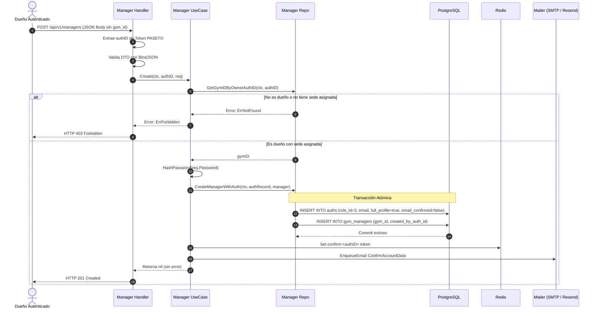

# 👔 Feature: Encargados del Gimnasio y Control de Caja (`features/manager`)

Documentación técnica y funcional del módulo de **Encargados de Sede (`GymManager`)** y **Control de Turnos de Caja (`CashRegister`)** en **Fitbase**.

---

## 1. Propósito y Alcance del Módulo

El módulo `manager` permite a los dueños de gimnasio (`Owner`) delegar la operación de sus sucursales mediante el alta y administración de encargados autorizados (`GymManager`). Cada encargado es asignado a una sede física específica, cuenta con credenciales de acceso independientes en `auths` (con rol `GymManager` = 3) y tiene las siguientes responsabilidades y capacidades operativas:
1. **Administración de perfil personal**: Consultar y actualizar sus datos de contacto básicos y subir/actualizar su fotografía de avatar.
2. **Operación de caja física (`CashRegister`)**:
   - Abrir su turno de caja registrando el fondo inicial (`open_cash`).
   - Mantener la trazabilidad de la sesión de caja activa.
   - Cerrar su caja al finalizar la jornada registrando el arqueo final (`close_cash`).
3. **Gestión por parte del dueño (`Owner`)**:
   - Registrar nuevos encargados (asociados automáticamente a su sucursal).
   - Listar con paginación y búsqueda (`search`) a todos los encargados de sus sedes.

---

## 2. ¿Qué se implementó?

### 2.1. Entidades y DTOs (`internal/features/manager/domain.go`)

- **DTOs de Entrada (`Request`) y Parámetros de Consulta**:
  - `CreateRequest`: Payload exclusivo para el dueño (`email`, `password`, `first_name`, `last_name`, `phone`). La sede (`gym_id`) se infiere del dueño autenticado.
  - `UpdateRequest` (manejado en handler): Modificación de perfil del encargado (`first_name`, `last_name`, `phone`, todos opcionales).
  - `ManagerQueryParams` (`utils.ParseManagerQuery`): Paginación y búsqueda (`page`, `page_size`, `search`).
  - `OpenCashRegisterRequest`: Apertura de turno con `gym_id` y monto de apertura `open_cash`.
  - `CloseCashRegisterRequest`: Cierre de turno con monto final `close_cash`.
- **DTOs de Salida (`Response`)**:
  - `Items`: Datos del encargado para listados por sede, combinando información de `gym_managers`, `auths`, `files` (avatar) y nombre de la sede `gyms`. Incluye `avatar_url` y omite campos internos como `slug`.
  - `PaginatedItems`: Envuelve la colección paginada (`data: []Items`) y los metadatos de paginación (`paginate: models.Pagination` con `total`, `total_pages`, `page`, `page_size`).
  - `Detail`: Perfil detallado del encargado (`id`, `auth_id`, `first_name`, `last_name`, `phone`, `avatar_url`).
  - `CashRegisterStatusResponse`: Estado de la sesión de caja física con timestamps, montos y bandera `is_open`.
- **Constructores y Funciones Utilitarias**:
  - `NewManager(gymID, createdByAuthID uint64, firstName, lastName, phone string) (*models.GymManager, error)`.
  - `NewCashRegister(gymID, authID uint64, openCash float64) (*models.CashRegister, error)`.
  - `BuildUpdateData(firstName *string, lastName *string, phone *string) map[string]any`.

### 2.2. Casos de Uso (`internal/features/manager/usecase.go`)

- `Create(...)`:
  - Obtiene el gimnasio asociado al dueño directamente mediante `GetGymIDByOwnerAuthID` en una única consulta con `JOIN` entre `gyms` y `owners` por `authID`.
  - Verifica que el correo electrónico no esté registrado previamente.
  - Hashea la contraseña con `bcrypt`.
  - Ejecuta una transacción atómica para crear `models.Auth` (con `RoleID = 3`, `FullProfile = true`, `EmailConfirmed = false`, `Active = true`) e insertar en `gym_managers`.
  - Emite token de confirmación de correo en Redis y encola el email transaccional con plantilla HTML.
  - Retorna `error` (la creación responde confirmación simple sin payload redundante).
- `GetAllManagersByGym(...)`: Lista los encargados registrados por el dueño autenticado (`*PaginatedItems`) con soporte para paginación (`page`, `pageSize`) y filtro de búsqueda difusa (`query`). Resuelve la URL pública del avatar mediante `utils.BuildEvidenceURL(slug)`.
- `GetDetailByAuthID(...)`: Consulta el perfil detallado del encargado en sesión (`*Detail`), optimizado con caché en Redis (`manager_profile_<authID>` con TTL de 10 min) y resolución de `AvatarURL`.
- `Update(...)`: Actualiza campos de perfil (`first_name`, `last_name`, `phone`) directamente por `authID` mediante `BuildUpdateData` e invalida la caché del perfil en Redis.
- `UploadAvatar(...)`: Optimiza la imagen (`utils.OptimizeImage`) y en una transacción atómica guarda el archivo en `files` y actualiza `avatar_id` directamente por `auth_id` mediante `UpdateAvatarByAuthID`. Invalida la caché del perfil en Redis.
- `OpenCashRegister(...)`: Verifica que el encargado no tenga ya un turno de caja abierto en esa sede; crea el registro de caja con `open_time = now`.
- `CloseCashRegister(...)`: Localiza la caja activa del encargado en turno, estampa `close_time = now` y registra el arqueo final.
- `GetCurrentCashRegister(...)`: Consulta el turno de caja física activo (`close_time IS NULL`) del encargado logueado.

### 2.3. Repositorio (`internal/features/manager/repository.go`)

- `WithTransaction(fn func(repo *PostgresRepository) error) error`: Ejecución de transacciones GORM.
- `CreateManagerWithAuth(ctx context.Context, authRecord *models.Auth, manager *models.GymManager) error`: Transacción atómica en PostgreSQL que asegura consistencia entre `auths` y `gym_managers`.
- `GetActiveCashRegister(ctx context.Context, gymID, authID uint64) (*models.CashRegister, error)`: Consulta filtrando por `close_time IS NULL`.
- `GetActiveCashRegisterByAuthID(ctx context.Context, authID uint64) (*models.CashRegister, error)`.
- `OpenCashRegister(ctx context.Context, register *models.CashRegister) error`.
- `CloseCashRegister(ctx context.Context, registerID uint64, closeCash float64, closeTime time.Time) error`.
- `GetAllByGymID(ctx context.Context, authID uint64, offset int, limit int, query string) ([]Items, int64, error)`: Consulta paginada filtrando por `created_by_auth_id` y con filtros de búsqueda por nombre, apellido, correo y teléfono, con joins a `gyms`, `auths` y `files`, ordenado descendentemente por fecha de creación. Retorna la lista y el total de registros.
- `GetDetailByAuthID(ctx context.Context, authID uint64) (*Detail, error)`: Consulta del detalle/perfil con join a `auths` y `files` filtrando por `auth_id`.
- `GetGymIDByOwnerAuthID(ctx context.Context, authID uint64) (uint64, error)`: Obtiene en una sola consulta (`INNER JOIN owners`) el ID del gimnasio del dueño a partir de su `auth_id`.
- `ExistsByAuthID(ctx context.Context, authID uint64) (bool, error)`: Comprueba si existe un encargado registrado para ese `auth_id`.
- `CreateFile(ctx context.Context, file *models.File) error`: Inserta el registro del archivo de imagen.
- `Update(ctx context.Context, authID uint64, data map[string]any) error`: Actualiza los datos de `gym_managers` por `auth_id`.
- `UpdateAvatarByAuthID(ctx context.Context, authID uint64, avatarID uint64) error`: Actualiza `avatar_id` en `gym_managers` directamente por `auth_id`.
- `ExistsAuthByEmail(ctx context.Context, email string) (bool, error)`.

### 2.4. Endpoints HTTP y Controladores

| Método | Ruta | Middleware | Handler | Descripción |
| :--- | :--- | :--- | :--- | :--- |
| `POST` | `/api/v1/managers` | `Auth`, `Idempotency` | `CreateManager` | Alta de encargado (sede resuelta automáticamente desde la sesión del dueño) |
| `GET` | `/api/v1/managers/me` | `Auth`, `Idempotency` | `GetDetailsMe` | Consulta del perfil propio del encargado autenticado |
| `PUT` | `/api/v1/managers/me` | `Auth`, `Idempotency` | `Update` | Actualización de datos de perfil del encargado autenticado |
| `POST` | `/api/v1/managers/me/upload-avatar` | `Auth`, `Idempotency` | `UploadAvatar` | Subida / actualización del avatar del encargado en sesión |
| `GET` | `/api/v1/gyms/managers` | `Auth`, `Idempotency` | `GetAllManagersByGym` | Listado paginado de encargados creados por el dueño autenticado |
| `POST` | `/api/v1/cash-register/open` | `Auth`, `Idempotency` | `OpenCashRegister` | Apertura de turno de caja física por el encargado |
| `POST` | `/api/v1/cash-register/close` | `Auth`, `Idempotency` | `CloseCashRegister` | Cierre de turno de caja física por el encargado |
| `GET` | `/api/v1/cash-register/current` | `Auth`, `Idempotency` | `GetCurrentCashRegister` | Consulta de la caja activa en el turno actual |

---

## 3. ¿Por qué se tomaron estas decisiones técnicas? (ADR)

### 3.1. Restricción Estricta de Alta Exclusiva por el Dueño y Resolución Automática de Sede
- **Decisión**: Los encargados no tienen un endpoint público de autorregistro. Su alta se efectúa exclusivamente mediante `POST /api/v1/managers`. La sede (`gym_id`) no requiere ser enviada por el frontend; el backend valida que el usuario sea dueño y resuelve su gimnasio asignado en una sola consulta (`GetGymIDByOwnerAuthID`).
- **Justificación**: Simplifica la integración frontend y previene manipulación indebida de asignación de gimnasios. Un dueño asigna personal únicamente al gimnasio que le pertenece.

### 3.2. Transacción Atómica entre `Auth` y `GymManager`
- **Decisión**: La creación de credenciales en `auths` y el registro de perfil en `gym_managers` se realizan en una única transacción atómica `CreateManagerWithAuth`.
- **Justificación**: Si fallara la asignación de sucursal o los datos de contacto, no debe quedar una cuenta de autenticación huérfana en la base de datos. Ambos registros nacen juntos o se aborta la operación completa con `ROLLBACK`.

### 3.3. Control de Turnos Únicos de Caja Física
- **Decisión**: El sistema no permite abrir una nueva caja física si el encargado ya tiene un registro con `close_time IS NULL`.
- **Justificación**: Garantiza la trazabilidad contable. Cada encargado es responsable de un único turno a la vez, evitando descuadres de efectivo y solapamientos de dinero en el mostrador.

### 3.4. Paginación y Búsqueda Consolidada de Encargados
- **Decisión**: El listado de encargados en `GET /api/v1/gyms/managers` no recibe `gym_id` en la URL ni requiere consultas adicionales; se filtra directamente por `created_by_auth_id = ?` del dueño en sesión e integra búsqueda multidominio en `first_name`, `last_name`, `email` y `phone`.
- **Justificación**: Permite a gimnasios con alto volumen de personal navegar de forma eficiente con metadatos estándar (`total`, `total_pages`, `page`, `page_size`), evitando sobrecarga de transferencia de datos.

### 3.5. Caché Distribuida con Redis para Perfiles de Encargados
- **Decisión**: Las consultas de perfil (`GET /api/v1/managers/me`) se almacenan en caché en Redis (`manager_profile_<authID>`) por 10 minutos y se invalidan reactivamente tanto al actualizar datos (`PUT /api/v1/managers/me`) como al subir un nuevo avatar (`POST /api/v1/managers/me/upload-avatar`).
- **Justificación**: Reduce el impacto de lecturas repetitivas contra PostgreSQL en cada carga del panel de administración del encargado.

---

## 4. Flujo de Interacción



---

## 5. Contratos de API

### 5.1. Alta de Encargado por el Dueño
- **Ruta**: `POST /api/v1/managers`
- **Autenticación**: `Bearer <token_paseto>` (Dueño)
- **Request Body**:
```json
{
  "email": "recepcion.central@fitbase.io",
  "password": "PasswordEncargado123!",
  "first_name": "Valeria",
  "last_name": "García",
  "phone": "+525533334444"
}
```
- **Respuesta Exitosa (201 Created)**:
```json
{
  "message": "Encargado registrado exitosamente. Se ha enviado un correo de confirmación."
}
```

---

### 5.2. Consulta de Perfil del Encargado en Sesión
- **Ruta**: `GET /api/v1/managers/me`
- **Autenticación**: `Bearer <token_paseto>` (Encargado)
- **Descripción**: Obtiene los datos del perfil del encargado autenticado. Se almacena en caché en Redis durante 10 minutos.
- **Respuesta Exitosa (200 OK)**:
```json
{
  "data": {
    "id": 1,
    "auth_id": 20,
    "first_name": "Valeria",
    "last_name": "García",
    "phone": "+525533334444",
    "avatar_url": "http://localhost:5173/evidence/managers/avatars/slug-del-avatar.jpg"
  }
}
```
- **Respuesta de Error si no existe (404 Not Found)**:
```json
{
  "message": "No se encontró el detalle del encargado"
}
```

---

### 5.3. Actualización de Perfil del Encargado
- **Ruta**: `PUT /api/v1/managers/me`
- **Autenticación**: `Bearer <token_paseto>` (Encargado)
- **Request Body** (campos opcionales):
```json
{
  "first_name": "Valeria",
  "last_name": "García López",
  "phone": "+525599887766"
}
```
- **Respuesta Exitosa (200 OK)**:
```json
{
  "message": "User updated successfully"
}
```

---

### 5.4. Subida / Actualización de Avatar de Encargado
- **Ruta**: `POST /api/v1/managers/me/upload-avatar`
- **Autenticación**: `Bearer <token_paseto>` (Encargado)
- **Content-Type**: `multipart/form-data`
- **Body**:
  - `image` (archivo binario, imagen jpg/png/webp)
- **Descripción**: Permite al encargado subir o renovar su fotografía de perfil. El sistema optimiza automáticamente la imagen, la almacena en el directorio `managers/avatars`, actualiza el campo `avatar_id` de la entidad `GymManager` e invalida la caché en Redis.
- **Respuesta Exitosa (200 OK)**:
```json
{
  "message": "Avatar uploaded successfully"
}
```
- **Respuesta de Error si no se envía imagen válida (400 Bad Request)**:
```json
{
  "message": "no se encontró el archivo de imagen"
}
```

---

### 5.5. Listado Paginado de Encargados por Sede (Dueño)
- **Ruta**: `GET /api/v1/gyms/managers`
- **Autenticación**: `Bearer <token_paseto>` (Dueño de la sede)
- **Query Parameters**:
  - `page` *(opcional, entero positivo, default: `1`)*: Número de página.
  - `page_size` *(opcional, entero positivo, default: `10`)*: Cantidad de registros por página.
  - `search` *(opcional, string)*: Término de búsqueda filtrando en nombre, apellido, correo o teléfono.
- **Descripción**: Permite al dueño consultar todo el personal administrativo y de recepción registrado en sus sedes con estructura paginada.
- **Respuesta Exitosa (200 OK)**:
```json
{
  "data": {
    "data": [
      {
        "id": 1,
        "gym_id": 1,
        "gym_name": "Fitbase Central",
        "auth_id": 20,
        "created_by_auth_id": 15,
        "first_name": "Valeria",
        "last_name": "García",
        "phone": "+525533334444",
        "email": "recepcion.central@fitbase.io",
        "avatar_url": "http://localhost:5173/evidence/managers/avatars/slug-del-avatar.jpg",
        "created_at": "2026-10-13T01:45:00Z"
      }
    ],
    "paginate": {
      "total": 1,
      "total_pages": 1,
      "page": 1,
      "page_size": 10
    }
  }
}
```

---

### 5.6. Apertura de Turno de Caja Física
- **Ruta**: `POST /api/v1/cash-register/open`
- **Autenticación**: `Bearer <token_paseto>` (Encargado)
- **Request Body**:
```json
{
  "gym_id": 1,
  "open_cash": 500.00
}
```
- **Respuesta Exitosa (201 Created)**:
```json
{
  "message": "Caja abierta exitosamente",
  "data": {
    "id": 1,
    "gym_id": 1,
    "auth_id": 20,
    "open_time": "2026-10-13T08:00:00Z",
    "close_time": null,
    "open_cash": 500.00,
    "close_cash": 0.00,
    "is_open": true
  }
}
```
- **Respuesta si ya existe una caja abierta (409 Conflict)**:
```json
{
  "message": "Ya existe una caja abierta para este turno en este gimnasio"
}
```

---

### 5.7. Cierre de Turno de Caja Física
- **Ruta**: `POST /api/v1/cash-register/close`
- **Autenticación**: `Bearer <token_paseto>` (Encargado)
- **Request Body**:
```json
{
  "close_cash": 3250.00
}
```
- **Respuesta Exitosa (200 OK)**:
```json
{
  "message": "Caja cerrada exitosamente",
  "data": {
    "id": 1,
    "gym_id": 1,
    "auth_id": 20,
    "open_time": "2026-10-13T08:00:00Z",
    "close_time": "2026-10-13T16:00:00Z",
    "open_cash": 500.00,
    "close_cash": 3250.00,
    "is_open": false
  }
}
```
- **Respuesta si no hay turno abierto para cerrar (404 Not Found)**:
```json
{
  "message": "No hay ninguna caja abierta activa para este usuario"
}
```

---

### 5.8. Consulta de Estado de Caja Activa
- **Ruta**: `GET /api/v1/cash-register/current`
- **Autenticación**: `Bearer <token_paseto>` (Encargado)
- **Respuesta Exitosa (200 OK)**:
```json
{
  "data": {
    "id": 1,
    "gym_id": 1,
    "auth_id": 20,
    "open_time": "2026-10-13T08:00:00Z",
    "close_time": null,
    "open_cash": 500.00,
    "close_cash": 0.00,
    "is_open": true
  }
}
```
- **Respuesta si no hay caja abierta (404 Not Found)**:
```json
{
  "message": "No hay ninguna caja abierta activa"
}
```
