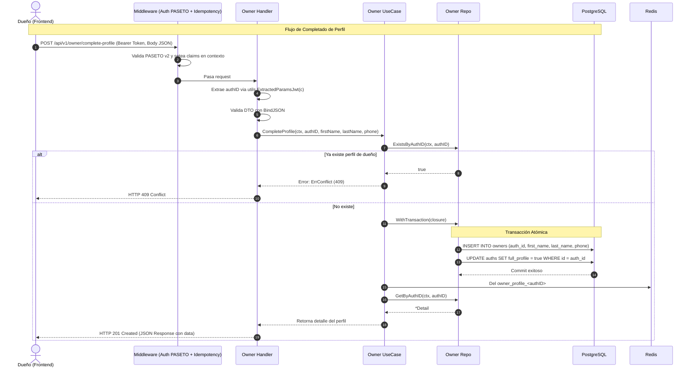

# 👑 Feature: Perfil de Dueño (`features/owner`)
## path
`./internal/features/owner`

Documentación técnica y funcional del módulo de **Dueño de Gimnasios (`Owner`)**, que gestiona la identidad comercial, la cuenta raíz propietaria de las sedes y el ciclo de vida de completado de perfil dentro de **Fitbase**.

---

## 1. Propósito y Alcance del Módulo

En el ecosistema **Fitbase**, el **Dueño (`Owner`)** es la entidad comercial raíz. De su cuenta dependen:
- La creación y configuración de sedes (`Gym`).
- La definición de planes de membresía (`Plan`).
- El alta y administración de encargados autorizados para recepción y caja (`GymManager`).
- La supervisión consolidada de ingresos y reportes.

Este módulo resuelve:
1. El completado atómico de la información del perfil del dueño (`POST /api/v1/owner/complete-profile`), vinculando la cuenta de autenticación (`auths`) con el registro comercial (`owners`) y marcando la cuenta con `full_profile = true`.
2. La consulta (`GET /api/v1/owner/me`) y actualización (`PUT /api/v1/owner/me`) segura del perfil propio del dueño autenticado, blindado contra ataques IDOR y acelerado mediante caché distribuida en Redis.
3. La carga y actualización de fotografía de avatar (`POST /api/v1/owner/me/upload-avatar`), con optimización de imagen y persistencia en el subsistema de archivos.
4. Prerrequisito de onboarding: Registro público diferenciado gestionado en el módulo de autenticación (`POST /api/v1/auth/register-owner`).

---

## 2. ¿Qué se implementó?

### 2.1. Entidades y DTOs (`internal/features/owner/domain.go`)

- **DTOs de Entrada (`Request`)**:
  - `CompleteOwnerProfileRequest`: Payload requerido para completar el perfil tras confirmar el correo electrónico (`first_name`, `last_name`, `phone`, todos obligatorios con validación de longitud).
  - `UpdateRequest`: Payload con campos opcionales (`first_name`, `last_name`, `phone`) para actualizar datos del perfil.
- **DTOs de Salida (`Response`)**:
  - `Detail`: Representación de detalle del perfil del dueño, combinando columnas de `owners`, el correo verificado de `auths` y el avatar resuelto (`id`, `auth_id`, `first_name`, `last_name`, `phone`, `email`, `avatar_url`). El campo interno `slug` se oculta en la serialización JSON (`json:"-"`).
- **Constructores y Updaters**:
  - `New(authID uint64, firstName, lastName, phone string) (*models.Owner, error)`: Valida tipos, no nulidad y no vacíos antes de instanciar la entidad.
  - `BuildUpdateData(firstName *string, lastName *string, phone *string) map[string]any`: Convierte los punteros a cadenas no vacías en un mapa clave-valor para ejecutar actualizaciones parciales seguras mediante GORM `Updates(map)`.

### 2.2. Casos de Uso (`internal/features/owner/usecase.go`)

- `CompleteProfile(ctx context.Context, authID uint64, firstName, lastName, phone string) (*Detail, error)`:
  - Valida que `authID > 0`.
  - Verifica mediante `ExistsByAuthID` que el dueño no haya completado ya su perfil (previene duplicados con HTTP 409 Conflict).
  - Instancia el modelo mediante `New(...)`.
  - Ejecuta una transacción atómica `WithTransaction`:
    - Inserta en la tabla `owners`.
    - Actualiza `full_profile = true` en la tabla `auths`.
  - Invalida cualquier entrada previa en la caché de Redis (`owner_profile_<authID>`).
  - Retorna el perfil completo recién consolidado obtenido vía `GetByAuthID`.
- `GetProfile(ctx context.Context, authID uint64) (*Detail, error)`:
  - Consulta la caché en Redis (`owner_profile_<authID>`). Si está presente y deserializa correctamente, responde de inmediato.
  - Si hay cache-miss, consulta el repositorio `GetByAuthID`, construye la URL pública del avatar (`utils.BuildEvidenceURL(user.Slug)`), almacena en Redis en una goroutine asíncrona (TTL 10 minutos) y retorna los datos.
- `Update(ctx context.Context, authID uint64, firstName *string, lastName *string, phone *string) error`:
  - Construye el mapa de actualización con `BuildUpdateData`. Si no hay cambios, retorna de inmediato sin consultar la base de datos.
  - Invalida la caché del perfil en Redis (`invalidateOwnerProfileCache`).
  - Actualiza la fila en `owners` mediante `repo.Update`.
- `UploadAvatar(ctx context.Context, authID uint64, slug, path, mimeType string, size int64) error`:
  - Optimiza la imagen mediante `utils.OptimizeImage` (reduciendo tamaño y convirtiendo a formato eficiente).
  - Ejecuta una transacción atómica `WithTransaction`:
    - Registra el archivo en `files`.
    - Actualiza el campo `avatar_id` del dueño directamente por su `auth_id` con `UpdateAvatarByAuthID`.
  - Invalida la caché del perfil en Redis.

### 2.3. Repositorio (`internal/features/owner/repository.go`)

- `WithTransaction(fn func(repo *PostgresRepository) error) error`: Expone el runner transaccional con `r.db.Transaction(...)`, instanciando un `txRepo` vinculado a `tx`.
- `GetByAuthID(ctx context.Context, authID uint64) (*Detail, error)`: Consulta optimizada con `Select(...)`, `JOIN auths ON auths.id = owners.auth_id` y `LEFT JOIN files ON files.author_id = owners.auth_id`.
- `ExistsByAuthID(ctx context.Context, authID uint64) (bool, error)`: Verifica eficientemente con `Count(&count)` si ya existe un registro de dueño para dicho `auth_id`.
- `Create(ctx context.Context, owner *models.Owner) error`: Inserción del registro con propagación de contexto y traducción de errores vía `helper.TranslateDBError(err)`.
- `Update(ctx context.Context, authID uint64, data map[string]any) error`: Actualización directa con mapas sobre `owners` filtrando por `auth_id = ?`. Retorna `ErrNotFound` si `RowsAffected == 0`.
- `MarkAuthProfileCompleted(ctx context.Context, authID uint64) error`: Actualización de `full_profile = true` sobre la tabla `auths` dentro de la sesión transaccional.
- `CreateFile(ctx context.Context, file *models.File) error`: Inserta el registro de archivo de avatar en la tabla `files`.
- `UpdateAvatarByAuthID(ctx context.Context, authID uint64, avatarID uint64) error`: Actualiza `avatar_id` directamente en `owners` filtrando por `auth_id`.

### 2.4. Endpoints HTTP y Controladores

| Método | Ruta | Middleware | Handler | Descripción |
| :--- | :--- | :--- | :--- | :--- |
| `POST` | `/api/v1/auth/register-owner` | `RateLimit`, `Idempotency` | `RegisterOwner` *(auth)* | Registro público asignando `RoleID = 2` (`Owner`) y despacho de email de confirmación |
| `POST` | `/api/v1/owner/complete-profile` | `Auth`, `Idempotency` | `CompleteProfile` | Alta de datos del dueño y activación de `full_profile = true` en transacción |
| `GET` | `/api/v1/owner/me` | `Auth`, `Idempotency` | `GetProfile` | Consulta del perfil del dueño en sesión (con caché Redis y resolución de avatar) |
| `PUT` | `/api/v1/owner/me` | `Auth`, `Idempotency` | `UpdateProfile` | Actualización parcial de datos del perfil del dueño logueado |
| `POST` | `/api/v1/owner/me/upload-avatar` | `Auth`, `Idempotency` | `UploadAvatar` | Subida / actualización del avatar fotográfico del dueño en sesión |

---

## 3. ¿Por qué se tomaron estas decisiones técnicas? (ADR)

### 3.1. Separación de Registro de Dueño vs Cliente
- **Decisión**: Se implementó un endpoint explícito `POST /api/v1/auth/register-owner` en lugar de aceptar un parámetro `role_id` enviado por el cliente en el body de `/register`.
- **Justificación**: Aceptar el rol en el body es una vulnerabilidad de escalación de privilegios (Mass Assignment). Al tener una ruta dedicada, el backend asigna internamente `models.RoleOwnerID` (`2`), garantizando que nadie pueda inyectar roles administrativos arbitrarios.

### 3.2. Transacción de Completado de Perfil sin Acoplamiento Cruzado
- **Decisión**: El método `MarkAuthProfileCompleted` reside directamente en `owner.PostgresRepository`.
- **Justificación**: En GORM, para que dos operaciones sean estrictamente atómicas (si una falla, la otra hace rollback), ambas deben ejecutarse sobre la misma instancia transaccional `*gorm.DB` (`tx`). Si el caso de uso de `owner` importara el repositorio de `auth`, la sesión transaccional se rompería a menos que se inyecte `tx` en repositorios ajenos, lo cual generaría acoplamiento cruzado y riesgo de dependencias circulares. La responsabilidad de completar el perfil de dueño le pertenece al módulo `owner`.

### 3.3. Prevención de IDOR (Insecure Direct Object References)
- **Decisión**: Ningún endpoint del actor en sesión recibe `:id` en la URL o en el cuerpo JSON (por ejemplo, nunca se usa `/owner/:id` para el propio dueño).
- **Justificación**: Las rutas usan la convención semántica `/me`. El identificador `authID` se extrae de forma no falsificable directamente del token criptográfico PASETO v2 mediante `utils.ExtractedParamsJwt(c)`. Un usuario autenticado no tiene manera de consultar ni editar el perfil de otro dueño.

### 3.4. Actualizaciones Seguras con Mapas (`BuildUpdateData`)
- **Decisión**: Se utilizó `BuildUpdateData` para poblar un `map[string]any` y alimentar `db.Updates(data)`.
- **Justificación**: En GORM, actualizar mediante structs ignora los campos vacíos ("zero values"). El mapa asegura que solo las claves deseadas se envíen en la sentencia `UPDATE`, previniendo sobreescrituras accidentales y permitiendo flexibilidad en modificaciones parciales.

### 3.5. Caché Distribuida con Redis e Invalidación Reactiva
- **Decisión**: El perfil del dueño (`GET /api/v1/owner/me`) se guarda en Redis con clave `owner_profile_<authID>` (TTL de 10 min) y se invalida reactivamente en `CompleteProfile`, `Update` y `UploadAvatar`.
- **Justificación**: Acelera significativamente la navegación del panel del dueño reduciendo lecturas a la base de datos PostgreSQL, garantizando a la vez frescura inmediata ante cualquier cambio de información o fotografía.

---

## 4. Flujo de Interacción



---

## 5. Contratos de API

### 5.1. Registro de Dueño
- **Ruta**: `POST /api/v1/auth/register-owner`
- **Autenticación**: Pública
- **Request Body**:
```json
{
  "email": "dueno.gym@fitbase.io",
  "password": "PasswordSegura123!"
}
```
- **Respuesta Exitosa (201 Created)**:
```json
{
  "message": "Dueño registrado exitosamente por favor verifica tu correo para activar tu cuenta"
}
```
- **Respuesta de Error de Validación (400 Bad Request)**:
```json
{
  "message": "Formato de correo o contraseña inválido"
}
```

---

### 5.2. Completado de Perfil de Dueño
- **Ruta**: `POST /api/v1/owner/complete-profile`
- **Autenticación**: `Bearer <token_paseto>`
- **Request Body**:
```json
{
  "first_name": "Carlos",
  "last_name": "Mendoza",
  "phone": "+525512345678"
}
```
- **Respuesta Exitosa (201 Created)**:
```json
{
  "message": "Perfil de dueño completado exitosamente",
  "data": {
    "id": 1,
    "auth_id": 15,
    "first_name": "Carlos",
    "last_name": "Mendoza",
    "phone": "+525512345678",
    "email": "dueno.gym@fitbase.io",
    "avatar_url": ""
  }
}
```
- **Respuesta si ya fue completado (409 Conflict)**:
```json
{
  "message": "El perfil de dueño ya ha sido completado previamente"
}
```

---

### 5.3. Obtener Perfil del Dueño Autenticado
- **Ruta**: `GET /api/v1/owner/me`
- **Autenticación**: `Bearer <token_paseto>`
- **Descripción**: Consulta el perfil del dueño en sesión. Se almacena en caché en Redis durante 10 minutos.
- **Respuesta Exitosa (200 OK)**:
```json
{
  "data": {
    "id": 1,
    "auth_id": 15,
    "first_name": "Carlos",
    "last_name": "Mendoza",
    "phone": "+525512345678",
    "email": "dueno.gym@fitbase.io",
    "avatar_url": "http://localhost:5173/evidence/owners/avatars/slug-del-avatar.jpg"
  }
}
```
- **Respuesta si no existe perfil (404 Not Found)**:
```json
{
  "message": "Usuario no encontrado"
}
```

---

### 5.4. Actualizar Perfil del Dueño Autenticado
- **Ruta**: `PUT /api/v1/owner/me`
- **Autenticación**: `Bearer <token_paseto>`
- **Request Body** (todos los campos son opcionales):
```json
{
  "first_name": "Carlos Alberto",
  "last_name": "Mendoza López",
  "phone": "+525598765432"
}
```
- **Respuesta Exitosa (200 OK)**:
```json
{
  "message": "Perfil de dueño actualizado exitosamente"
}
```

---

### 5.5. Subida / Actualización de Avatar de Dueño
- **Ruta**: `POST /api/v1/owner/me/upload-avatar`
- **Autenticación**: `Bearer <token_paseto>`
- **Content-Type**: `multipart/form-data`
- **Body**:
  - `image` (archivo binario, imagen jpg/png/webp)
- **Descripción**: Permite al dueño subir o actualizar su fotografía de perfil. El sistema optimiza automáticamente la imagen, la almacena en el directorio `owners/avatars`, crea el registro en `files`, actualiza `avatar_id` en la tabla `owners` e invalida la caché en Redis.
- **Respuesta Exitosa (200 OK)**:
```json
{
  "message": "Avatar uploaded successfully"
}
```
- **Respuesta de Error si no se envía archivo válido (400 Bad Request)**:
```json
{
  "message": "no se encontró el archivo de imagen"
}
```
