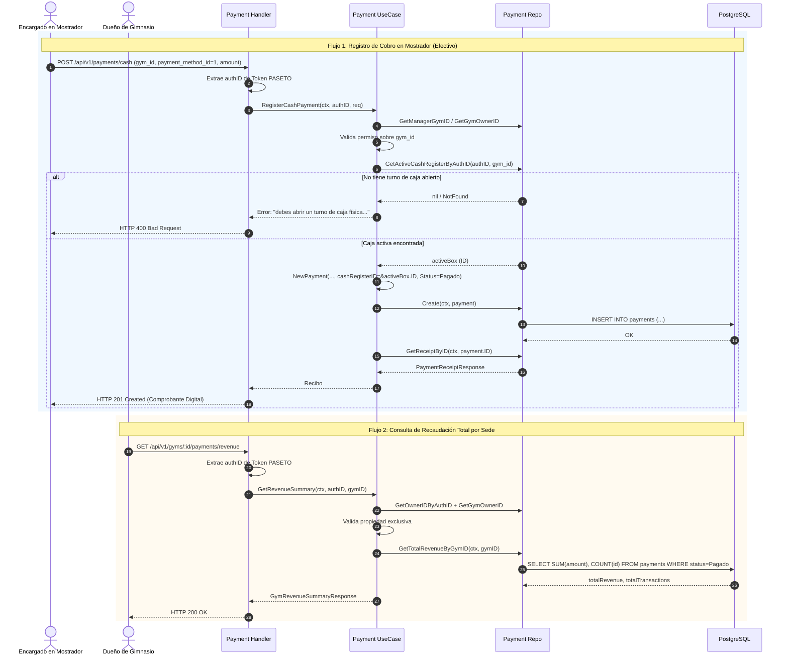
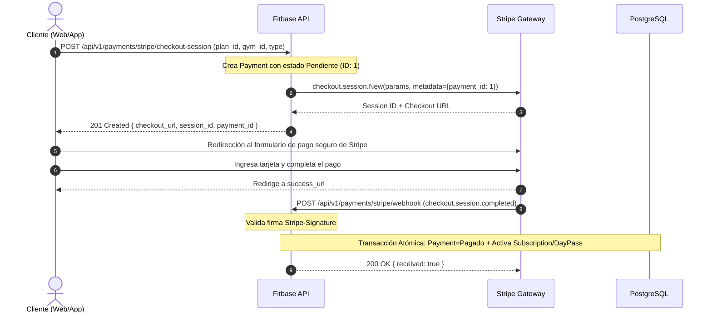

# 💰 Feature: Registro de Pagos y Caja (`features/payment`)

Documentación técnica y funcional del módulo de **Pagos y Transacciones Financieras (`Payment`)** en **Fitbase**.

---

## 1. Propósito y Alcance del Módulo

El módulo `payment` registra y audita los flujos monetarios que ingresan a las sedes de Fitbase, derivados de la contratación de membresías recurrentes (`Subscription`), compra de pases diarios (`DayPass`) o servicios adicionales en el mostrador.

Principales capacidades:
1. **Cobro presencial en mostrador (`POST /api/v1/payments/cash`)**: Permite a los encargados registrar pagos en efectivo o tarjeta física.
2. **Trazabilidad obligatoria de efectivo con Caja Física (`CashRegister`)**: Si el método de pago seleccionado es **Efectivo** (`PaymentMethodCashID = 1`), el sistema exige y enlaza automáticamente el ID de la caja física abierta y activa del encargado en turno.
3. **Reportes consolidados de recaudación (`GET /api/v1/gyms/:id/payments/revenue`)**: Proporciona al Dueño de la sede el total monetario recaudado y el conteo total de transacciones completadas.
4. **Auditoría de transacciones de la sede (`GET /api/v1/gyms/:id/payments`)**: Listado paginado de todas las operaciones financieras con desglose de método de pago y estado.
5. **Historial de pagos del cliente (`GET /api/v1/payments/my-payments`)**: Autoconsulta del historial de recibos del socio autenticado.

---

## 2. ¿Qué se implementó?

### 2.1. Entidades y DTOs (`internal/features/payment/domain.go`)

- **DTOs de Entrada (`Request`)**:
  - `RegisterPaymentRequest`: Payload enviado en el cobro (`gym_id`, `payment_method_id`, `amount`, `subscription_id` opcional, `day_pass_id` opcional).
- **DTOs de Salida (`Response`)**:
  - `PaymentReceiptResponse`: Comprobante digital de la transacción (`id`, `gym_id`, `gym_name`, `payment_method_id`, `payment_method_name`, `payment_status_id`, `payment_status_name`, `amount`, `subscription_id`, `day_pass_id`, `cash_register_id`, `payment_date`, `created_at`).
  - `GymRevenueSummaryResponse`: Resumen financiero para el dueño (`gym_id`, `gym_name`, `total_revenue`, `total_transactions`).
  - `PaymentListItem`: Elemento consolidado para listados administrativos y de cliente.
  - `PaginatedPaymentSummary`: Envoltorio con metadatos de paginación (`Data`, `Paginate`).
- **Constructor**:
  - `NewPayment(gymID, paymentMethodID, statusID uint64, amount float64, subID, dayPassID, cashRegisterID *uint64) (*models.Payment, error)`: Valida montos estrictamente positivos (`amount > 0`) e IDs válidos.

### 2.2. Casos de Uso (`internal/features/payment/usecase.go`)

- `RegisterCashPayment(...)`:
  - Valida que el ejecutor sea el Encargado asignado a la sede o el Dueño propietario.
  - Valida que el método de pago exista y esté activo en el catálogo.
  - Si el pago es en **Efectivo**, consulta en `cash_registers` si el operador cuenta con una caja abierta (`close_time IS NULL`). Si no la tiene, rechaza el cobro con un error descriptivo.
  - Inserta el pago con estado `Pagado` (`PaymentStatusPaidID = 2`).
  - Retorna el recibo digital enriquecido con joins de sede y catálogos.
- `GetRevenueSummary(...)`:
  - Valida que el usuario sea el Dueño propietario de la sede (`gymOwnerID == ownerID`).
  - Ejecuta la agregación `COALESCE(SUM(amount), 0)` filtrando por pagos completados.
- `GetAllByGym(...)`:
  - Listado paginado de pagos de la sucursal para el Dueño.
- `GetMyPayments(...)`:
  - Resuelve el `userID` del cliente logueado a través del token PASETO y obtiene sus recibos vinculados a suscripciones o pases diarios.

### 2.3. Repositorio (`internal/features/payment/repository.go`)

- `WithTransaction(...)`: Soporte transaccional GORM.
- `Create(ctx context.Context, payment *models.Payment) error`: Inserción de la transacción.
- `GetTotalRevenueByGymID(ctx context.Context, gymID uint64) (float64, int64, error)`: Agregación SQL directa.
- `GetAllByGymID(...)`: Listado con Joins a `gyms`, `payment_methods` y `payment_statuses`.
- `GetAllByUserID(...)`: Consulta con Joins a `subscriptions` y `day_passes` vinculando `user_id`.
- `GetActiveCashRegisterByAuthID(ctx context.Context, authID, gymID uint64) (*models.CashRegister, error)`.
- `GetReceiptByID(ctx context.Context, paymentID uint64) (*PaymentReceiptResponse, error)`.
- Métodos de autorización IDOR: `GetGymOwnerID`, `GetGymName`, `GetOwnerIDByAuthID`, `GetManagerGymID`, `GetUserDetailsByAuthID`.

### 2.4. Endpoints HTTP y Controladores

| Método | Ruta | Middleware | Descripción |
| :--- | :--- | :--- | :--- |
| `POST` | `/api/v1/payments/cash` | `Auth`, `Idempotency` | Registro de cobro en mostrador (efectivo o terminal física) por Encargado o Dueño |
| `GET` | `/api/v1/gyms/:id/payments/revenue` | `Auth`, `Idempotency` | Resumen de ingresos y transacciones totales (solo Dueño) |
| `GET` | `/api/v1/gyms/:id/payments` | `Auth`, `Idempotency` | Listado paginado de transacciones de la sede (solo Dueño) |
| `GET` | `/api/v1/payments/my-payments` | `Auth`, `Idempotency` | Historial paginado de recibos del cliente en sesión |
| `POST` | `/api/v1/payments/stripe/checkout-session` | `Auth`, `Idempotency` | Creación de sesión de checkout en Stripe para socios autenticados (suscripción o pase) |
| `POST` | `/api/v1/payments/stripe/guest-checkout` | `Idempotency` | **Público**: Creación de sesión de checkout en Stripe para visitantes sin cuenta que compran pase de día |
| `GET` | `/api/v1/payments/stripe/session/:session_id` | `Idempotency` | **Público**: Consulta de estado de pago de la sesión de Stripe Checkout (socios e invitados) |
| `POST` | `/api/v1/payments/stripe/webhook` | Ninguno (valida `Stripe-Signature`) | Webhook asíncrono para confirmación de eventos de cobro en Stripe |

---

## 3. ¿Por qué se tomaron estas decisiones técnicas? (ADR)

### 3.1. Enlace Obligatorio de Efectivo a la Caja Física Activa
- **Decisión**: Cuando `PaymentMethodID == 1` (Efectivo), el sistema busca el turno abierto (`close_time IS NULL`) del encargado ejecutor. Si no existe, la transacción se aborta.
- **Justificación**: Elimina la recepción de dinero "fantasma". Todo billete o moneda recibido debe ingresar a un turno de caja formalmente abierto, facilitando el cuadre y arqueo (`close_cash`) al terminar el turno.

### 3.2. Pagos Digitales Desacoplados de Caja Física
- **Decisión**: Los pagos con tarjeta o transferencia no exigen `cash_register_id` (`nil`).
- **Justificación**: El dinero electrónico entra directamente a las cuentas bancarias o pasarelas de pago del gimnasio, por lo que no forma parte del efectivo en gaveta física que debe cuadrarse al cierre de turno.

### 3.3. Agregación Eficiente en una Sola Consulta SQL
- **Decisión**: El cálculo del total recaudado y conteo de transacciones se realiza con `COALESCE(SUM(amount), 0)` y `COUNT(id)` en una única consulta contra PostgreSQL.
- **Justificación**: Evita transferir miles de registros a la memoria de Go para sumar montos, aprovechando la velocidad nativa del motor de base de datos.

### 3.4. Prevención de IDOR y Aislamiento de Reportes
- **Decisión**: Los endpoints de recaudación (`/revenue`) y transacciones de sede (`/payments`) validan estrictamente que el `authID` del token PASETO sea el Dueño propietario de esa sede en específico.

---

## 4. Flujo de Interacción



---

## 5. Contratos de API

### 5.1. Registro de Cobro en Mostrador (Efectivo o Terminal)
- **Ruta**: `POST /api/v1/payments/cash`
- **Autenticación**: `Bearer <token_paseto>` (Encargado o Dueño)
- **Ejemplo A: Cobro de Membresía**:
```json
{
  "gym_id": 1,
  "payment_method_id": 1,
  "amount": 599.00,
  "subscription_id": 8,
  "day_pass_id": null
}
```
- **Ejemplo B: Cobro de Pase de un Día (Visitante o Socio)**:
```json
{
  "gym_id": 1,
  "payment_method_id": 2,
  "amount": 100.00,
  "subscription_id": null,
  "day_pass_id": 15
}
```
*(Nota: `payment_method_id = 1` para Efectivo, `2` para Tarjeta de Crédito en terminal física, `3` para Tarjeta de Débito en terminal física).*
- **Response `201 Created`**:
```json
{
  "message": "Pago registrado exitosamente",
  "data": {
    "id": 105,
    "gym_id": 1,
    "gym_name": "Fitbase Central",
    "payment_method_id": 1,
    "payment_method_name": "Efectivo",
    "payment_status_id": 2,
    "payment_status_name": "Pagado",
    "amount": 599.00,
    "subscription_id": 8,
    "cash_register_id": 12,
    "payment_date": "2026-10-13T19:50:00Z",
    "created_at": "2026-10-13T19:50:00Z"
  }
}
```
- **Response `400 Bad Request` (Sin turno de caja)**:
```json
{
  "message": "debes abrir un turno de caja física antes de registrar cobros en efectivo"
}
```

---

### 5.2. Resumen Total de Ingresos (Dueño)
- **Ruta**: `GET /api/v1/gyms/:id/payments/revenue`
- **Autenticación**: `Bearer <token_paseto>` (Dueño de la sede)
- **Response `200 OK`**:
```json
{
  "data": {
    "gym_id": 1,
    "gym_name": "Fitbase Central",
    "total_revenue": 145890.50,
    "total_transactions": 245
  }
}
```
- **Response `403 Forbidden`**:
```json
{
  "message": "Solo el propietario de la sede puede consultar los reportes de ingresos"
}
```

---

### 5.3. Listado de Transacciones de la Sede
- **Ruta**: `GET /api/v1/gyms/:id/payments?page=1&page_size=10`
- **Autenticación**: `Bearer <token_paseto>` (Dueño de la sede)
- **Parámetros de Ruta**:
  - `:id` (uint64, requerido): Identificador de la sede.
- **Parámetros Query**:
  - `page` (int, opcional, default: 1): Número de página.
  - `page_size` (int, opcional, default: 10): Tamaño de página.
- **Response `200 OK`**:
```json
{
  "data": {
    "data": [
      {
        "id": 105,
        "gym_id": 1,
        "gym_name": "Fitbase Central",
        "payment_method_id": 1,
        "payment_method_name": "Efectivo",
        "payment_status_id": 2,
        "payment_status_name": "Pagado",
        "amount": 599.00,
        "subscription_id": 8,
        "day_pass_id": null,
        "cash_register_id": 12,
        "payment_date": "2026-10-13T19:50:00Z",
        "created_at": "2026-10-13T19:50:00Z"
      }
    ],
    "paginate": {
      "page": 1,
      "page_size": 10,
      "total": 1,
      "total_pages": 1
    }
  }
}
```

---

### 5.4. Historial de Pagos del Cliente
- **Ruta**: `GET /api/v1/payments/my-payments?page=1&page_size=10`
- **Autenticación**: `Bearer <token_paseto>` (Cliente)
- **Parámetros Query**:
  - `page` (int, opcional, default: 1): Número de página.
  - `page_size` (int, opcional, default: 10): Tamaño de página.
- **Response `200 OK`**:
```json
{
  "data": {
    "data": [
      {
        "id": 105,
        "gym_id": 1,
        "gym_name": "Fitbase Central",
        "payment_method_id": 1,
        "payment_method_name": "Efectivo",
        "payment_status_id": 2,
        "payment_status_name": "Pagado",
        "amount": 599.00,
        "subscription_id": 8,
        "day_pass_id": null,
        "cash_register_id": 12,
        "payment_date": "2026-10-13T19:50:00Z",
        "created_at": "2026-10-13T19:50:00Z"
      }
    ],
    "paginate": {
      "page": 1,
      "page_size": 10,
      "total": 1,
      "total_pages": 1
    }
  }
}
```

---

## 6. Integración con Pasarela Digital Stripe (Fase 10)

### 6.1. Flujo de Checkout y Conciliación por Webhook



### 6.2. Contratos de API de Stripe

#### 6.2.1. Crear Sesión de Checkout
- **Ruta**: `POST /api/v1/payments/stripe/checkout-session`
- **Autenticación**: `Bearer <token_paseto>` (Cliente)
- **Request Body**:
```json
{
  "gym_id": 1,
  "plan_id": 3,
  "type": "subscription",
  "auto_renew": true
}
```
- **Response `201 Created`**:
```json
{
  "message": "Sesión de checkout creada exitosamente",
  "data": {
    "session_id": "cs_test_a1b2c3d4e5f6",
    "checkout_url": "https://checkout.stripe.com/c/pay/cs_test_a1b2c3d4e5f6",
    "payment_id": 204,
    "amount": 799.00
  }
}
```

#### 6.2.2. Webhook de Stripe
- **Ruta**: `POST /api/v1/payments/stripe/webhook`
- **Autenticación**: Validación de firma vía cabecera `Stripe-Signature` contra `STRIPE_WEBHOOK_SECRET`.
- **Payload**: Evento JSON crudo emitido por Stripe (`checkout.session.completed`, `checkout.session.expired`).
- **Response `200 OK`**:
```json
{
  "received": true
}
```

#### 6.2.3. Consultar Estado de Sesión de Checkout
- **Ruta**: `GET /api/v1/payments/stripe/session/:session_id`
- **Autenticación**: `Bearer <token_paseto>` (Cliente)
- **Response `200 OK`**:
```json
{
  "data": {
    "session_id": "cs_test_a1b2c3d4e5f6",
    "payment_status": "paid",
    "status": "complete",
    "payment_id": 204,
    "amount_total": 799.00,
    "currency": "mxn"
  }
}
```
