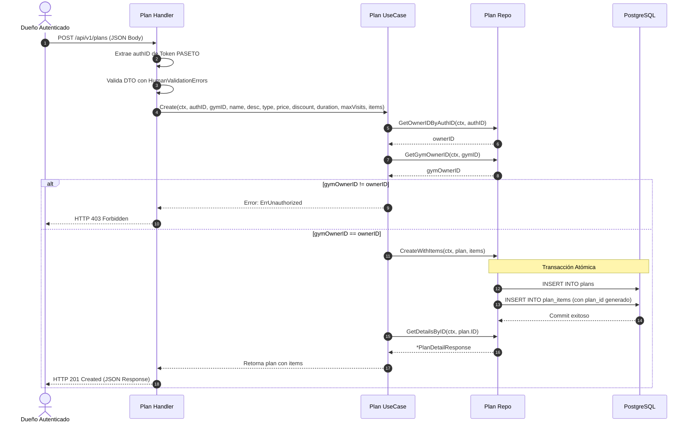

# 📋 Feature: Planes de Membresía y Beneficios (`features/plan`)

Documentación técnica y funcional del módulo de **Planes de Membresía (`Plan`)** y sus beneficios asociados (**`PlanItem`**) en **Fitbase**.

---

## 1. Propósito y Alcance del Módulo

El módulo `plan` permite a los propietarios de gimnasio (`Owner`) diseñar su catálogo comercial de suscripciones y membresías (mensuales, anuales, pases de visita o planes personalizados), asignando precios, descuentos promocionales, vigencia en días y beneficios detallados (`PlanItem`). Asimismo, expone el catálogo activo para que los clientes finales puedan explorar las ofertas disponibles por cada sede de gimnasio.

---

## 2. ¿Qué se implementó?

### 2.1. Entidades y DTOs (`internal/features/plan/domain.go`)

- **DTOs de Entrada (`Request`)**:
  - `PlanItemRequest`: Nombre y descripción de cada beneficio incluido en el plan.
  - `UpdatePlanItemRequest`: Modificación individual de campos de un beneficio (`name`, `description`).
  - `CreatePlanRequest`: Datos del plan (`gym_id`, `name`, `description`, `price`, `discount`, `duration`, `plan_type`, `max_visits`, `items`).
  - `UpdatePlanRequest`: Modificaciones parciales (`name`, `description`, `price`, `discount`, `duration`, `plan_type`, `max_visits`, `active`).
- **DTOs de Salida (`Response`)**:
  - `PlanPublicItem`: Representación de cada beneficio incluido en el plan.
  - `PlanDetailResponse`: Vista detallada del plan con `gym_name`, `final_price` calculado, vigencia y colección de `items`.
  - `EnrollmentResponse`: Vista consolidada de inscripción para el cliente con `has_active_subscription`, `active_subscription` y `plans` con la bandera `is_current`.
  - `PaginatedPlanSummary`: Estructura paginada que cumple el estándar de Fitbase.
- **Constructores y Updaters**:
  - `New(gymID uint64, name, description, planType string, price, discount float64, duration int, maxVisits *int) (*models.Plan, error)`.
  - `BuildPlanUpdateData(name, description, planType string, price, discount *float64, duration *int, maxVisits *int, active *bool) map[string]any`.
  - `BuildPlanItemUpdateData(req UpdatePlanItemRequest) map[string]any`.

### 2.2. Casos de Uso (`internal/features/plan/usecase.go`)

- `Create(...)`: Valida que el gimnasio pertenezca al dueño autenticado, valida reglas de negocio (`price > 0`, `duration >= 1`, `discount` de 0 a 100), crea el plan y sus items atómicamente, y retorna el detalle completo.
- `Update(...)`: Valida que el plan a modificar pertenezca a una sede del dueño autenticado para prevenir IDOR, y aplica actualización parcial mediante mapas.
- `GetDetailsByID(...)`: Consulta el detalle de un plan específico precargando sus items y calculando el precio final con descuento.
- `GetAllByGymID(...)`: Lista los planes de una sede. Si es la vista administrativa completa (`activeOnly = false`), valida que el usuario sea Dueño o Encargado de la sede.
- `GetEnrollmentPlans(...)`: Consulta el catálogo de planes disponibles para compra y la membresía activa del socio, retornando directamente `*EnrollmentResponse` sin intermediarios ni bucles de transformación en memoria.
- `AddItem(...)`: Agrega un nuevo beneficio a un plan existente, validando permisos del dueño sobre la sede y retornando el item persistido.
- `UpdateItem(...)`: Actualiza un beneficio existente, verificando pertenencia del plan al dueño y que el item pertenezca estrictamente al plan indicado.
- `DeleteItem(...)`: Elimina un beneficio individual con doble validación de propiedad y pertenencia al plan.

### 2.3. Repositorio (`internal/features/plan/repository.go`)

- `WithTransaction(fn func(repo *PostgresRepository) error) error`: Ejecutor transaccional con `r.db.Transaction(...)`.
- `CreateWithItems(ctx context.Context, plan *models.Plan, items []models.PlanItem) error`: Inserción atómica en transacción; asigna el `plan.ID` generado a cada `PlanItem`.
- `GetByID(ctx context.Context, id uint64) (*models.Plan, error)`: Consulta básica de la entidad.
- `GetDetailsByID(ctx context.Context, id uint64) (*PlanDetailResponse, error)`: Consulta optimizada con `Preload("Gym")` y `Preload("PlanItems")`.
- `GetAllByGymID(ctx context.Context, gymID uint64, activeOnly bool) ([]PlanDetailResponse, error)`: Catálogo de planes ordenado por precio.
- `GetEnrollmentPlans(ctx context.Context, authID, gymID uint64) (*EnrollmentResponse, error)`: Consulta unificada en un solo viaje (Single Round-Trip) con `jsonb_agg` y `jsonb_build_object`, mapeando directo a la entidad de dominio `EnrollmentResponse`.
- `Update(ctx context.Context, id uint64, data map[string]any) error`: Actualización con mapa y contexto.
- `GetGymOwnerID(ctx context.Context, gymID uint64) (uint64, error)`: Obtiene el `owner_id` de la sede para validación de pertenencia.
- `GetOwnerIDByAuthID(ctx context.Context, authID uint64) (uint64, error)`: Obtiene el `owner_id` del usuario autenticado.
- `GetManagerGymID(ctx context.Context, authID uint64) (uint64, error)`: Obtiene el `gym_id` del encargado para validación de permisos.
- `CreateItem(ctx context.Context, item *models.PlanItem) error`: Inserción individual de un beneficio.
- `GetItemByID(ctx context.Context, id uint64) (*models.PlanItem, error)`: Consulta de un beneficio por su ID.
- `UpdateItem(ctx context.Context, id uint64, data map[string]any) error`: Actualización parcial de campos de un beneficio.
- `DeleteItem(ctx context.Context, id uint64) error`: Eliminación de un beneficio por su ID.

### 2.4. Endpoints HTTP y Controladores

| Método | Ruta | Middleware | Descripción |
| :--- | :--- | :--- | :--- |
| `GET` | `/api/v1/plans/:id` | `Idempotency` | Detalle público de un plan y sus beneficios |
| `GET` | `/api/v1/gyms/:id/plans` | `Idempotency` | Listado público de planes activos por sede de gimnasio |
| `POST` | `/api/v1/plans` | `Auth`, `Idempotency` | Creación de plan con beneficios por el dueño de la sede |
| `PUT` | `/api/v1/plans/:id` | `Auth`, `Idempotency` | Modificación de plan con validación estricta de propiedad |
| `GET` | `/api/v1/gyms/:id/all-plans` | `Auth`, `Idempotency` | Listado de todos los planes (activos e inactivos) para el staff (Dueño y Encargados) |
| `GET` | `/api/v1/gyms/:id/plans/enrollment` | `Auth`, `Idempotency` | Planes activos cruzados con suscripción activa para flujo de inscripción del cliente |
| `POST` | `/api/v1/plans/:id/items` | `Auth`, `Idempotency` | Agrega un nuevo beneficio a un plan existente |
| `PUT` | `/api/v1/plans/:id/items/:item_id` | `Auth`, `Idempotency` | Actualiza el nombre o descripción de un beneficio |
| `DELETE` | `/api/v1/plans/:id/items/:item_id` | `Auth`, `Idempotency` | Elimina un beneficio de un plan existente |

---

## 3. ¿Por qué se tomaron estas decisiones técnicas? (ADR)

### 3.1. Creación Atómica de Plan con `PlanItems`
- **Decisión**: La inserción del plan y sus items se ejecuta dentro del método `CreateWithItems` bajo una transacción atómica `WithTransaction`.
- **Justificación**: Un plan de membresía no debe existir sin sus beneficios prometidos ni viceversa. Si falla la inserción de alguno de los items (por ejemplo, por longitud de texto o falla de red), GORM ejecuta `ROLLBACK` automático, impidiendo planes corruptos o huérfanos.

### 3.2. Prevención de IDOR entre Sedes y Dueños
- **Decisión**: Antes de crear un plan para `gym_id` o modificar `plan_id`, el caso de uso compara `GetGymOwnerID` contra `GetOwnerIDByAuthID`.
- **Justificación**: Garantiza que un dueño no pueda registrar planes en gimnasios ajenos ni modificar planes de otros propietarios cambiando simplemente el ID en la URL (`/plans/:id`) o en el cuerpo de la petición.

### 3.3. Cálculo de Precio Final en DTO (`FinalPrice`)
- **Decisión**: El precio final con descuento se computa en tiempo de consulta: `FinalPrice = Price * (1 - Discount/100)`.
- **Justificación**: Almacenar precios calculados en columnas redundantes genera inconsistencias si se modifica el precio base o el descuento de forma independiente. Mantener el cálculo en el DTO asegura precisión matemática continua.

### 3.4. Single Round-Trip Query con `jsonb_agg` para Items del Plan (`GetDetailsByID` y `GetAllByGymID`)
- **Decisión**: Tanto `GetDetailsByID` como `GetAllByGymID` consolidan los datos del plan, el nombre de la sede y toda la lista de beneficios (`PlanItem`) en una sola consulta SQL utilizando `COALESCE(jsonb_agg(DISTINCT jsonb_build_object(...)) FILTER (...), '[]'::jsonb)`.
- **Justificación**: Elimina la necesidad de hacer queries secundarios separados o `Preload` múltiples, minimizando los viajes de red (round-trips) entre el backend y PostgreSQL, y entregando una estructura lista para su deserialización directa en Go.

### 3.5. Gestión Granular Independiente de Beneficios (`PlanItem`)
- **Decisión**: Se implementaron endpoints individuales (`POST /plans/:id/items`, `PUT /plans/:id/items/:item_id`, `DELETE /plans/:id/items/:item_id`) para operar sobre los beneficios una vez que el plan ya fue creado, en lugar de forzar a reenviar el arreglo completo del plan.
- **Justificación**: Proporciona máxima flexibilidad a las interfaces Web y Móvil (siguiendo el patrón de horarios y fotografías de `features/gym`), permitiendo agregar, editar o suprimir un beneficio puntual sin riesgo de sobreescribir inadvertidamente el resto de los items ni recalcular campos del plan.
- **Seguridad**: Cada operación aplica doble validación de seguridad: verifica que el plan pertenezca a una sede del dueño autenticado y comprueba que el `item_id` corresponda estrictamente al `plan_id` de la ruta, impidiendo ataques de manipulación de identificadores (IDOR).

---

## 4. Flujo de Interacción



---

## 5. Contratos de API

### 5.1. Crear Plan con Beneficios
- **Ruta**: `POST /api/v1/plans`
- **Autenticación**: `Bearer <token_paseto>`
- **Request Body**:
```json
{
  "gym_id": 1,
  "name": "Membresía Black Anual",
  "description": "Acceso total a todas las áreas del gimnasio durante 365 días",
  "price": 5999.00,
  "discount": 15.00,
  "duration": 365,
  "plan_type": "Anual",
  "max_visits": null,
  "items": [
    { "name": "Acceso Ilimitado", "description": "Entrada sin límite de horarios" },
    { "name": "Área de Pesas y Cardio", "description": "Uso libre de todas las máquinas" },
    { "name": "Lockers y Regaderas", "description": "Uso de vestidores incluidos" },
    { "name": "Pase de Invitado Mensual", "description": "1 pase de invitado gratis por mes" }
  ]
}
```
- **Respuesta Exitosa (201 Created)**:
```json
{
  "message": "Plan creado exitosamente",
  "data": {
    "id": 1,
    "gym_id": 1,
    "gym_name": "Fitbase Central",
    "name": "Membresía Black Anual",
    "description": "Acceso total a todas las áreas del gimnasio durante 365 días",
    "price": 5999.00,
    "discount": 15.00,
    "final_price": 5099.15,
    "duration": 365,
    "plan_type": "Anual",
    "max_visits": null,
    "active": true,
    "items": [
      { "id": 1, "name": "Acceso Ilimitado", "description": "Entrada sin límite de horarios" },
      { "id": 2, "name": "Área de Pesas y Cardio", "description": "Uso libre de todas las máquinas" },
      { "id": 3, "name": "Lockers y Regaderas", "description": "Uso de vestidores incluidos" },
      { "id": 4, "name": "Pase de Invitado Mensual", "description": "1 pase de invitado gratis por mes" }
    ]
  }
}
```

---

### 5.2. Actualizar Plan
- **Ruta**: `PUT /api/v1/plans/:id`
- **Autenticación**: `Bearer <token_paseto>`
- **Request Body**:
```json
{
  "price": 6499.00,
  "discount": 10.00,
  "active": true
}
```
- **Respuesta Exitosa (200 OK)**:
```json
{
  "message": "Plan actualizado exitosamente"
}
```

---

### 5.3. Catálogo de Planes Activos por Sede (Clientes)
- **Ruta**: `GET /api/v1/gyms/:id/plans`
- **Autenticación**: Pública
- **Respuesta Exitosa (200 OK)**:
```json
{
  "data": [
    {
      "id": 1,
      "gym_id": 1,
      "gym_name": "Fitbase Central",
      "name": "Membresía Black Anual",
      "description": "Acceso total a todas las áreas del gimnasio durante 365 días",
      "price": 5999.00,
      "discount": 15.00,
      "final_price": 5099.15,
      "duration": 365,
      "plan_type": "Anual",
      "max_visits": null,
      "active": true,
      "items": [
        { "id": 1, "name": "Acceso Ilimitado", "description": "Entrada sin límite de horarios" }
      ]
    }
  ]
}
```

---

### 5.4. Detalle de Plan
- **Ruta**: `GET /api/v1/plans/:id`
- **Autenticación**: Pública
- **Parámetros de Ruta**:
  - `:id` (uint64, requerido): Identificador del plan.
- **Respuesta Exitosa (200 OK)**:
```json
{
  "data": {
    "id": 1,
    "gym_id": 1,
    "gym_name": "Fitbase Central",
    "name": "Membresía Black Anual",
    "description": "Acceso total a todas las áreas del gimnasio durante 365 días",
    "price": 5999.00,
    "discount": 15.00,
    "final_price": 5099.15,
    "duration": 365,
    "plan_type": "Anual",
    "max_visits": null,
    "active": true,
    "items": [
      { "id": 1, "name": "Acceso Ilimitado", "description": "Entrada sin límite de horarios" }
    ]
  }
}
```

---

### 5.5. Listado de Todos los Planes por Sede (Staff: Dueño y Encargados)
- **Ruta**: `GET /api/v1/gyms/:id/all-plans`
- **Autenticación**: `Bearer <token_paseto>` (Dueño o Encargado de la sede)
- **Parámetros de Ruta**:
  - `:id` (uint64, requerido): Identificador de la sede de gimnasio.
- **Descripción**: Retorna la colección completa de planes de la sede, incluyendo tanto los activos (`active = true`) como los archivados/inactivos (`active = false`), ordenados por precio ascendente. Exclusivo para el personal administrativo y operativo del gimnasio.
- **Respuesta Exitosa (200 OK)**:
```json
{
  "data": [
    {
      "id": 1,
      "gym_id": 1,
      "gym_name": "Fitbase Central",
      "name": "Membresía Black Anual",
      "description": "Acceso total a todas las áreas del gimnasio durante 365 días",
      "price": 5999.00,
      "discount": 15.00,
      "final_price": 5099.15,
      "duration": 365,
      "plan_type": "Anual",
      "max_visits": null,
      "active": true,
      "items": [
        { "id": 1, "name": "Acceso Ilimitado", "description": "Entrada sin límite de horarios" }
      ]
    },
    {
      "id": 2,
      "gym_id": 1,
      "gym_name": "Fitbase Central",
      "name": "Plan Promocional Verano (Inactivo)",
      "description": "Promoción temporal ya finalizada",
      "price": 199.00,
      "discount": 0.00,
      "final_price": 199.00,
      "duration": 30,
      "plan_type": "Mensual",
      "max_visits": null,
      "active": false,
      "items": []
    }
  ]
}
```
- **Respuesta de Error de Autorización (403 Forbidden)**:
```json
{
  "message": "No tienes autorización para consultar los planes de esta sede"
}
```

---

### 5.6. Agregar Beneficio a un Plan
- **Ruta**: `POST /api/v1/plans/:id/items`
- **Autenticación**: `Bearer <token_paseto>` (Dueño de la sede)
- **Parámetros de Ruta**:
  - `:id` (uint64, requerido): Identificador del plan.
- **Request Body**:
```json
{
  "name": "Acceso a Zona de Sauna y Spa",
  "description": "Uso libre de cabina de vapor y sauna seco"
}
```
- **Respuesta Exitosa (201 Created)**:
```json
{
  "message": "Beneficio agregado exitosamente",
  "data": {
    "id": 5,
    "name": "Acceso a Zona de Sauna y Spa",
    "description": "Uso libre de cabina de vapor y sauna seco"
  }
}
```

---

### 5.7. Actualizar Beneficio
- **Ruta**: `PUT /api/v1/plans/:id/items/:item_id`
- **Autenticación**: `Bearer <token_paseto>` (Dueño de la sede)
- **Parámetros de Ruta**:
  - `:id` (uint64, requerido): Identificador del plan.
  - `:item_id` (uint64, requerido): Identificador del beneficio a modificar.
- **Request Body**:
```json
{
  "name": "Acceso a Zona VIP y Spa",
  "description": "Uso libre de cabina de vapor, sauna y lockers exclusivos"
}
```
- **Respuesta Exitosa (200 OK)**:
```json
{
  "message": "Beneficio actualizado exitosamente"
}
```

---

### 5.8. Eliminar Beneficio
- **Ruta**: `DELETE /api/v1/plans/:id/items/:item_id`
- **Autenticación**: `Bearer <token_paseto>` (Dueño de la sede)
- **Parámetros de Ruta**:
  - `:id` (uint64, requerido): Identificador del plan.
  - `:item_id` (uint64, requerido): Identificador del beneficio a eliminar.
- **Respuesta Exitosa (200 OK)**:
```json
{
  "message": "Beneficio eliminado exitosamente"
}
```

---

### 5.9. Planes de Inscripción con Validación de Suscripción Activa (Cliente)
- **Ruta**: `GET /api/v1/gyms/:id/plans/enrollment`
- **Autenticación**: `Bearer <token_paseto>` (Cualquier usuario/cliente autenticado)
- **Parámetros de Ruta**:
  - `:id` (uint64, requerido): Identificador de la sede de gimnasio.
- **Descripción**: Resuelve en una sola petición el catálogo de planes disponibles para compra y valida en tiempo real si el cliente ya cuenta con una membresía activa en esa sede física. Para cada plan, la propiedad `is_current` indica si coincide con el plan contratado por el socio.
- **Respuesta Exitosa (200 OK) - Cliente con suscripción activa**:
```json
{
  "data": {
    "gym_id": 1,
    "gym_name": "Fitbase Central",
    "has_active_subscription": true,
    "active_subscription": {
      "id": 15,
      "slug": "019488a0-7b2a-7123-8945-abcdef123456",
      "plan_id": 2,
      "plan_name": "Plan Mensual Gold",
      "start_date": "2026-10-01",
      "end_date": "2026-10-31",
      "status_name": "Activo",
      "auto_renew": true
    },
    "plans": [
      {
        "id": 2,
        "gym_id": 1,
        "gym_name": "Fitbase Central",
        "name": "Plan Mensual Gold",
        "description": "Acceso ilimitado al gimnasio durante 30 días",
        "price": 599.00,
        "discount": 0.00,
        "final_price": 599.00,
        "duration": 30,
        "plan_type": "Mensual",
        "max_visits": null,
        "active": true,
        "is_current": true,
        "items": [
          { "id": 1, "name": "Área de pesas y cardio", "description": "Acceso sin restricción" }
        ]
      },
      {
        "id": 3,
        "gym_id": 1,
        "gym_name": "Fitbase Central",
        "name": "Plan Anual VIP",
        "description": "Acceso total anual",
        "price": 5999.00,
        "discount": 10.00,
        "final_price": 5399.10,
        "duration": 365,
        "plan_type": "Anual",
        "max_visits": null,
        "active": true,
        "is_current": false,
        "items": []
      }
    ]
  }
}
```
- **Respuesta Exitosa (200 OK) - Cliente sin suscripción activa**:
```json
{
  "data": {
    "gym_id": 1,
    "gym_name": "Fitbase Central",
    "has_active_subscription": false,
    "active_subscription": null,
    "plans": [
      {
        "id": 2,
        "gym_id": 1,
        "gym_name": "Fitbase Central",
        "name": "Plan Mensual Gold",
        "description": "Acceso ilimitado al gimnasio durante 30 días",
        "price": 599.00,
        "discount": 0.00,
        "final_price": 599.00,
        "duration": 30,
        "plan_type": "Mensual",
        "max_visits": null,
        "active": true,
        "is_current": false,
        "items": []
      }
    ]
  }
}
```
- **Respuesta de Error de No Encontrado (404 Not Found)**:
```json
{
  "message": "Gimnasio no encontrado"
}
```


