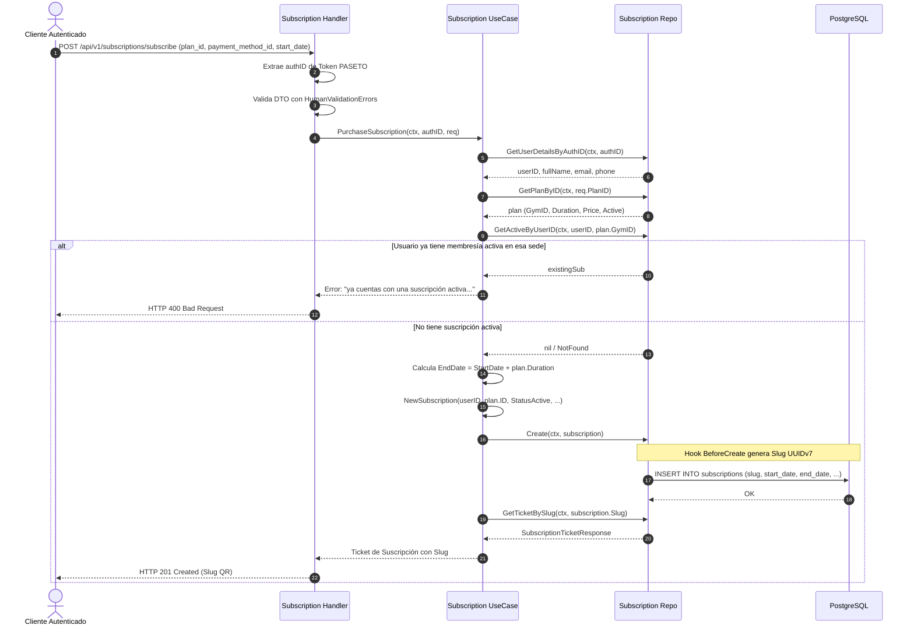

# 💳 Feature: Suscripciones y Membresías (`features/subscription`)

Documentación técnica y funcional del módulo de **Suscripciones y Membresías (`Subscription`)** en **Fitbase**.

---

## 1. Propósito y Alcance del Módulo

El módulo `subscription` gestiona el ciclo de vida de las membresías recurrentes o periódicas contratadas por los clientes (`User`) para acceder a las instalaciones y servicios de una sede física (`Gym`).

Principales capacidades:
1. **Contratación de planes (`POST /api/v1/subscriptions/subscribe`)**: El cliente adquiere un plan vigente indicando método de pago y fecha de inicio opcional.
2. **Cálculo automático de vigencia**: La fecha de vencimiento (`end_date`) se computa sumando la duración en días configurada en el plan (`Plan.Duration`).
3. **Control de duplicidad y solapamiento**: Se impide que un usuario contrate una nueva membresía en una sucursal si ya cuenta con una suscripción activa y vigente en esa misma sede.
4. **Emisión de credencial digital / QR**: Se asocia un identificador único seguro `Slug` (**UUIDv7**), el cual se utiliza para consultar el ticket de acceso y generar el código QR que se escaneará en los accesos físicos.
5. **Autoconsulta de membresías (`GET /api/v1/subscriptions/my-subscriptions`)**: Los clientes pueden auditar su historial y estado de suscripciones vigentes.
6. **Supervisión operativa y administrativa (`GET /api/v1/gyms/:id/subscriptions`)**: Dueños y Encargados pueden consultar los miembros suscritos a su sede con filtros por estado y paginación.
7. **Cancelación segura de membresías (`PUT /api/v1/subscriptions/:id/cancel`)**: Permite tanto al socio titular como al staff de la sede dar de baja una membresía activa, desactivando la autorenovación y actualizando su estado a Inactivo.

---

## 2. ¿Qué se implementó?

### 2.1. Entidades y DTOs (`internal/features/subscription/domain.go`)

- **DTOs de Entrada (`Request`)**:
  - `PurchaseSubscriptionRequest`: Payload para contratar (`plan_id`, `payment_method_id`, `start_date` opcional en formato YYYY-MM-DD, `auto_renew`).
- **DTOs de Salida (`Response`)**:
  - `SubscriptionTicketResponse`: Credencial digital y boleto QR (`id`, `slug`, `gym_id`, `gym_name`, `plan_id`, `plan_name`, `full_name`, `status_id`, `status_name`, `start_date`, `end_date`, `created_at`).
  - `SubscriptionDetailResponse`: Vista detallada administrativa con información del usuario, plan, sede, método de pago y timestamps.
  - `SubscriptionUserSummary`: Vista consolidada para el panel del cliente.
  - `PaginatedSubscriptionSummary`: Listado paginado administrativo.
  - `PaginatedUserSubscriptionSummary`: Listado paginado para el usuario cliente.
- **Constructores**:
  - `NewSubscription(userID, planID, statusID, paymentMethodID uint64, startDate, endDate time.Time, autoRenew bool) (*models.Subscription, error)`: Valida IDs positivos y congruencia temporal (`endDate >= startDate`).

### 2.2. Casos de Uso (`internal/features/subscription/usecase.go`)

- `PurchaseSubscription(...)`:
  - Obtiene el perfil del usuario autenticado a partir de su `authID` mediante el token PASETO.
  - Valida la existencia y estado activo del plan (`Plan.Active == true` y `Plan.Duration > 0`).
  - Valida que el cliente no posea ya una membresía con estado activo y `end_date >= CURRENT_DATE` en la misma sede.
  - Computa `startDate` (hoy si no se especificó) y valida que no sea en el pasado.
  - Computa `endDate = startDate.AddDate(0, 0, plan.Duration)`.
  - Persiste la entidad con estado inicial `Activo` (`StatusSubscriptionActiveID = 1`).
  - Retorna los datos del ticket con el `Slug` UUIDv7 para renderizado de QR.
- `GetMySubscriptions(...)`: Lista paginada de las suscripciones pertenecientes al usuario en sesión.
- `GetTicketBySlug(...)`: Obtiene la credencial digital a partir de su UUIDv7.
- `GetAllByGym(...)`: Lista administrativa con validación estricta de propiedad/asignación (Dueño o Encargado de la sede).
- `CancelSubscription(...)`: Cancela una suscripción activa con validación IDOR (el suscriptor titular, el dueño o el encargado de la sede). Actualiza `status_id = Inactivo` y `auto_renew = false`.

### 2.3. Repositorio (`internal/features/subscription/repository.go`)

- `WithTransaction(...)`: Envoltorio transaccional GORM.
- `Create(ctx context.Context, sub *models.Subscription) error`: Inserción en base de datos.
- `GetByID(ctx context.Context, id uint64) (*models.Subscription, error)`: Búsqueda directa por ID numérico.
- `GetBySlug(ctx context.Context, slug uuid.UUID) (*models.Subscription, error)`: Búsqueda directa por UUID.
- `GetTicketBySlug(ctx context.Context, slug uuid.UUID) (*SubscriptionTicketResponse, error)`: Consulta unificada con joins a `plans`, `gyms`, `users` y `status_subscriptions`.
- `GetActiveByUserID(ctx context.Context, userID, gymID uint64) (*models.Subscription, error)`: Comprobación de membresía activa y vigente (`end_date >= CURRENT_DATE`).
- `GetAllByGymID(ctx context.Context, gymID uint64, statusID uint64, offset, limit int) ([]SubscriptionDetailResponse, int64, error)`: Consulta paginada con filtros y joins completos.
- `GetAllByUserID(ctx context.Context, userID uint64, offset, limit int) ([]SubscriptionUserSummary, int64, error)`: Consulta optimizada de membresías del cliente.
- `UpdateStatus(ctx context.Context, id uint64, statusID uint64) error`: Cambio de estado (`Activo`, `Inactivo`, `Pendiente`, `Expirado`).
- `Cancel(ctx context.Context, id uint64) error`: Cancela la suscripción y desactiva la autorenovación.
- Métodos de autorización IDOR y perfiles: `GetUserDetailsByAuthID`, `GetPlanByID`, `GetGymOwnerID`, `GetOwnerIDByAuthID`, `GetManagerGymID`.

### 2.4. Endpoints HTTP y Controladores

| Método | Ruta | Middleware | Descripción |
| :--- | :--- | :--- | :--- |
| `POST` | `/api/v1/subscriptions/subscribe` | `Auth`, `Idempotency` | Contratación de suscripción para el usuario en sesión |
| `GET` | `/api/v1/subscriptions/my-subscriptions` | `Auth`, `Idempotency` | Historial y suscripciones activas del cliente |
| `GET` | `/api/v1/subscriptions/:slug/ticket` | `Idempotency` | Consulta pública del ticket QR mediante su Slug |
| `GET` | `/api/v1/gyms/:id/subscriptions` | `Auth`, `Idempotency` | Listado administrativo de suscripciones de una sede |
| `PUT` | `/api/v1/subscriptions/:id/cancel` | `Auth`, `Idempotency` | Cancelación de suscripción activa por el socio o personal autorizado |

---

## 3. ¿Por qué se tomaron estas decisiones técnicas? (ADR)

### 3.1. Prevención de Suscripciones Solapadas en la Misma Sede
- **Decisión**: Antes de crear una nueva suscripción, el caso de uso invoca `GetActiveByUserID(ctx, userID, plan.GymID)`. Si existe una suscripción con estado `Activo` cuya `end_date >= CURRENT_DATE`, la solicitud es rechazada.
- **Justificación**: Evita que un usuario contrate dos membresías simultáneas en la misma sucursal por error o doble clic, previniendo cobros duplicados y reclamos contables.

### 3.2. Cálculo Determinístico de Vigencia (`EndDate = StartDate + Duration`)
- **Decisión**: La duración se computa en días calendario en el backend y nunca es enviada o manipulada por el frontend.
- **Justificación**: Garantiza la integridad de las reglas comerciales configuradas por el dueño en el catálogo de planes.

### 3.3. Identificador Seguro `Slug` con UUIDv7
- **Decisión**: El hook `BeforeCreate` genera automáticamente un `Slug` de tipo `uuid.UUID` versión 7.
- **Justificación**:
  1. **Inmune a ataques de enumeración (IDOR)**: Impide que terceros adivinen credenciales o tickets de otros socios.
  2. **Indexación de alta eficiencia**: Al ser ordenado en el tiempo, evita la fragmentación de páginas en los índices B-Tree de PostgreSQL.
  3. **Portabilidad para Códigos QR**: El slug es una cadena compacta ideal para representar en códigos QR leídos por terminales o smartphones.

### 3.4. Prevención de IDOR y Extracción Criptográfica
- **Decisión**: El cliente no envía su ID de usuario en las URLs ni en el payload JSON; el sistema lo extrae de forma segura a partir del token PASETO mediante `utils.ExtractedParamsJwt(c)`.
- **Justificación**: Elimina la posibilidad de que un usuario suplante a otro o contrate suscripciones a nombre de terceros.

---

## 4. Flujo de Interacción



---

## 5. Contratos de API

### 5.1. Contratación de Suscripción
- **Ruta**: `POST /api/v1/subscriptions/subscribe`
- **Autenticación**: `Bearer <token_paseto>`
- **Request Body**:
```json
{
  "plan_id": 2,
  "payment_method_id": 2,
  "start_date": "2026-10-15",
  "auto_renew": false
}
```
- **Response `201 Created`**:
```json
{
  "message": "Suscripción adquirida exitosamente",
  "data": {
    "id": 8,
    "slug": "01926650-4ef1-7d1a-8bb4-098765432100",
    "gym_id": 1,
    "gym_name": "Fitbase Central",
    "plan_id": 2,
    "plan_name": "Plan Mensual Premium",
    "full_name": "Moy Morales",
    "status_id": 1,
    "status_name": "Activo",
    "start_date": "2026-10-15",
    "end_date": "2026-11-14",
    "created_at": "2026-10-13T02:05:00Z"
  }
}
```
- **Response `400 Bad Request`**:
```json
{
  "message": "ya cuentas con una suscripción activa en esta sede hasta el 2026-11-14"
}
```

---

### 5.2. Mis Suscripciones (Cliente)
- **Ruta**: `GET /api/v1/subscriptions/my-subscriptions?page=1&page_size=10`
- **Autenticación**: `Bearer <token_paseto>`
- **Response `200 OK`**:
```json
{
  "data": {
    "data": [
      {
        "id": 8,
        "slug": "01926650-4ef1-7d1a-8bb4-098765432100",
        "gym_id": 1,
        "gym_name": "Fitbase Central",
        "plan_id": 2,
        "plan_name": "Plan Mensual Premium",
        "plan_price": 599.00,
        "status_id": 1,
        "status_name": "Activo",
        "start_date": "2026-10-15",
        "end_date": "2026-11-14",
        "auto_renew": false,
        "created_at": "2026-10-13T02:05:00Z"
      }
    ],
    "paginate": {
      "page": 1,
      "page_size": 10,
      "total": 1,
      "total_pages": 1
    }
  }
}
```

---

### 5.3. Consulta de Ticket QR por Slug
- **Ruta**: `GET /api/v1/subscriptions/:slug/ticket`
- **Autenticación**: Pública
- **Parámetros**: `:slug` (UUIDv7)
- **Response `200 OK`**:
```json
{
  "data": {
    "id": 8,
    "slug": "01926650-4ef1-7d1a-8bb4-098765432100",
    "gym_id": 1,
    "gym_name": "Fitbase Central",
    "plan_id": 2,
    "plan_name": "Plan Mensual Premium",
    "full_name": "Moy Morales",
    "status_id": 1,
    "status_name": "Activo",
    "start_date": "2026-10-15",
    "end_date": "2026-11-14",
    "created_at": "2026-10-13T02:05:00Z"
  }
}
```
- **Response `404 Not Found`**:
```json
{
  "message": "Ticket no encontrado"
}
```

---

### 5.4. Listado Administrativo de Suscripciones por Sede
- **Ruta**: `GET /api/v1/gyms/:id/subscriptions?page=1&page_size=10&status_id=1`
- **Autenticación**: `Bearer <token_paseto>` (Dueño o Encargado)
- **Parámetros Query**:
  - `page` (int, opcional, default: 1): Número de página.
  - `page_size` (int, opcional, default: 10): Tamaño de página.
  - `status_id` (uint64, opcional): Filtrar por ID de estado de suscripción (1: Activo, etc.).
- **Response `200 OK`**:
```json
{
  "data": {
    "data": [
      {
        "id": 8,
        "slug": "01926650-4ef1-7d1a-8bb4-098765432100",
        "user_id": 3,
        "user_full_name": "Moy Morales",
        "user_email": "moy@fitbase.io",
        "user_phone": "+525511223344",
        "gym_id": 1,
        "gym_name": "Fitbase Central",
        "plan_id": 2,
        "plan_name": "Plan Mensual Premium",
        "plan_price": 599.00,
        "status_id": 1,
        "status_name": "Activo",
        "start_date": "2026-10-15",
        "end_date": "2026-11-14",
        "payment_method_id": 2,
        "payment_method_name": "Tarjeta de crédito",
        "auto_renew": false,
        "created_at": "2026-10-13T02:05:00Z"
      }
    ],
    "paginate": {
      "page": 1,
      "page_size": 10,
      "total": 1,
      "total_pages": 1
    }
  }
}
```
- **Response `403 Forbidden`**:
```json
{
  "message": "No tienes permiso para consultar las suscripciones de esta sede"
}
```

---

### 5.5. Cancelar Suscripción
- **Ruta**: `PUT /api/v1/subscriptions/:id/cancel`
- **Autenticación**: `Bearer <token_paseto>` (Socio titular, Dueño o Encargado de la sede)
- **Parámetros de Ruta**:
  - `:id` (uint64, requerido): Identificador de la suscripción a cancelar.
- **Descripción**: Permite dar de baja una membresía activa. Desactiva la autorenovación (`auto_renew = false`) y actualiza su estado a `Inactivo` (`status_id = 2`). Solo se pueden cancelar membresías en estado `Activo`.
- **Response `200 OK`**:
```json
{
  "message": "Suscripción cancelada exitosamente",
  "data": {
    "id": 15,
    "slug": "019488a0-7b2a-7123-8945-abcdef123456",
    "gym_id": 1,
    "gym_name": "Fitbase Central",
    "plan_id": 2,
    "plan_name": "Plan Mensual Gold",
    "full_name": "Moy Morales",
    "status_id": 2,
    "status_name": "Inactivo",
    "start_date": "2026-10-01",
    "end_date": "2026-10-31",
    "created_at": "2026-10-01T10:00:00Z"
  }
}
```
- **Response `400 Bad Request`**:
```json
{
  "message": "Solo se pueden cancelar suscripciones activas"
}
```
- **Response `403 Forbidden`**:
```json
{
  "message": "No tienes permiso para cancelar esta suscripción"
}
```
- **Response `404 Not Found`**:
```json
{
  "message": "Suscripción no encontrada"
}
```


