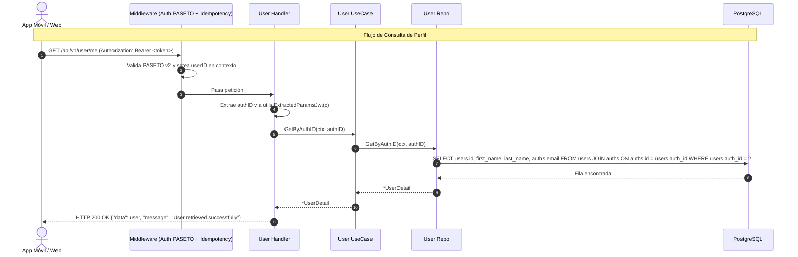

# 👤 Feature: Perfil de Usuario / Cliente (`features/user`)
## path
`./internal/features/user`

Documentación técnica y funcional del módulo de **Usuario Final / Cliente (`User`)**, que gestiona la información personal, datos de contacto y ciclo de vida del perfil de los socios de gimnasio dentro de **Fitbase**.

---

## 1. Propósito y Alcance del Módulo

En **Fitbase**, el **Usuario (`User`)** representa al cliente o socio final que adquiere planes de membresía, compra pases diarios y realiza ingresos a las sedes de gimnasio.

Este módulo resuelve:
1. La consulta segura del perfil del socio autenticado (`GET /api/v1/user/me`), vinculando las credenciales de `auths` con la información personal de la tabla `users`.
2. La actualización de datos personales (`PUT /api/v1/user/me`), permitiendo a los socios mantener su nombre y apellidos actualizados.
3. La prevención rigurosa de vulnerabilidades IDOR al extraer el identificador de cuenta (`authID`) exclusivamente del token criptográfico PASETO v2 validado por `authMiddleware()`.

---

## 2. ¿Qué se implementó?

### 2.1. Entidades y DTOs (`internal/features/user/domain.go`)

- **DTOs de Salida (`Response`)**:
  - `UserDetail`: Representación del perfil del usuario combinando datos de `users` y `auths` (`id`, `first_name`, `last_name`, `email`).
- **DTOs de Entrada (`Request` en `handler.go`)**:
  - `req` anónimo en handler: Campos opcionales para actualizar nombre y apellidos (`first_name` max 100, `last_name` max 100).
- **Constructores y Updaters**:
  - `New(authID uint64, firstName string, lastName string) (*models.User, error)`: Valida tipos, no nulidad y no vacíos antes de instanciar la entidad.
  - `BuildUserUpdateData(data *models.User) map[string]any`: Convierte los campos presentes del modelo en un mapa clave-valor para ejecutar actualizaciones parciales seguras mediante GORM `Updates(map)`.

### 2.2. Casos de Uso (`internal/features/user/usecase.go`)

- `GetByAuthID(ctx context.Context, authID uint64) (*UserDetail, error)`:
  - Consulta el detalle del socio haciendo join entre `users` y `auths`.
- `Update(ctx context.Context, authID uint64, data *models.User) error`:
  - Obtiene el registro del usuario asociado al `authID` y aplica las modificaciones de nombre y apellido mediante mapa atómico generado con `BuildUserUpdateData`.
- `Create(ctx context.Context, authID uint64, firstName, lastName string) (*models.User, error)`:
  - Creación transaccional con `WithTransaction` que inserta en `users` y actualiza `full_profile = true` en `auths`.
- `GetIDByAuthID(ctx context.Context, authID uint64) (uint64, error)`:
  - Resuelve el `userID` (clave primaria en `users`) a partir del `authID`.
- `GetEmailByID(ctx context.Context, id uint64) (string, error)`:
  - Resuelve el correo electrónico asociado al socio a partir de su ID de usuario.
- `UploadAvatar(...)`:
  - Firma preparada para la subida de fotografía de perfil de usuario.

### 2.3. Repositorio (`internal/features/user/repository.go`)

- `WithTransaction(fn func(repo *PostgresRepository) error) error`: Ejecución transaccional aislada sobre `*gorm.DB`.
- `GetByAuthID(ctx context.Context, authID uint64) (*UserDetail, error)`: Consulta unificada con `JOIN auths ON auths.id = users.auth_id` extrayendo `id`, `first_name`, `last_name` y `email`.
- `GetIDByAuthID(ctx context.Context, authID uint64) (uint64, error)`: Consulta rápida del ID primario del socio por `auth_id`.
- `GetEmailByID(ctx context.Context, id uint64) (string, error)`: Consulta el correo del usuario mediante join a `auths`.
- `Create(ctx context.Context, user *models.User) error`: Inserción de nuevo registro en la tabla `users`.
- `Update(ctx context.Context, id uint64, data map[string]any) error`: Actualización parcial con mapa por clave primaria de usuario (`id = ?`).
- `UpdateAvatarURL(ctx context.Context, userID uint64, avatarID uint64) error`: Actualiza `avatar_id` en la tabla `users`.
- `ChangeCompletedProfile(userId uint64, complete bool) error`: Actualiza la bandera `full_profile` en la tabla `auths`.

### 2.4. Endpoints HTTP y Controladores

Todos los endpoints se encuentran montados bajo el prefijo `/api/v1/user`:

| Método | Ruta | Middleware | Handler | Descripción |
| :--- | :--- | :--- | :--- | :--- |
| `GET` | `/api/v1/user/me` | `Auth`, `Idempotency` | `GetByAuthID` | Consulta del perfil del usuario socio en sesión (extrae `authID` del token PASETO) |
| `PUT` | `/api/v1/user/me` | `Auth`, `Idempotency` | `Update` | Actualización de nombre y apellidos del usuario socio en sesión |

---

## 3. ¿Por qué se tomaron estas decisiones técnicas? (ADR)

### 3.1. Prevención Total de IDOR mediante Convención `/me`
- **Decisión**: Los endpoints de perfil del usuario no reciben `:id` o `user_id` en la URL ni en el payload JSON.
- **Justificación**: El identificador `authID` se extrae de forma no falsificable del token criptográfico PASETO verificado por el middleware `authMiddleware()`. Esto garantiza que ningún usuario pueda consultar ni modificar el perfil de otro socio cambiando parámetros en peticiones HTTP.

### 3.2. Actualizaciones Parciales Seguras con Mapas (`BuildUserUpdateData`)
- **Decisión**: Se implementó `BuildUserUpdateData` para transformar el modelo a `map[string]any` antes de alimentar `db.Updates(data)`.
- **Justificación**: Previene el comportamiento predeterminado de GORM al actualizar structs, donde campos vacíos ("zero values") son ignorados o campos no enviados podrían sobreescribirse inadvertidamente.

---

## 4. Flujo de Interacción



---

## 5. Contratos de API

### 5.1. Obtener Perfil del Usuario Autenticado
- **Ruta**: `GET /api/v1/user/me`
- **Autenticación**: `Bearer <token_paseto>`
- **Headers Requeridos**:
  - `Authorization`: `Bearer <token_paseto>`
- **Respuesta Exitosa (200 OK)**:
```json
{
  "message": "User retrieved successfully",
  "data": {
    "id": 3,
    "first_name": "Carlos",
    "last_name": "Morales",
    "email": "carlos.fit@email.com"
  }
}
```
- **Respuesta de Error de Autenticación (401 Unauthorized)**:
```json
{
  "msg": "unauthorized"
}
```

---

### 5.2. Actualizar Perfil del Usuario Autenticado
- **Ruta**: `PUT /api/v1/user/me`
- **Autenticación**: `Bearer <token_paseto>`
- **Headers Requeridos**:
  - `Authorization`: `Bearer <token_paseto>`
  - `Content-Type`: `application/json`
- **Request Body** (campos opcionales):
```json
{
  "first_name": "Carlos",
  "last_name": "Morales López"
}
```
- **Campos del Body**:
  - `first_name` *(string, opcional, máx. 100 caracteres)*: Nombre del socio.
  - `last_name` *(string, opcional, máx. 100 caracteres)*: Apellidos del socio.
- **Respuesta Exitosa (200 OK)**:
```json
{
  "message": "User updated successfully"
}
```
- **Respuesta de Error de Validación (400 Bad Request)**:
```json
{
  "code": "VALIDATION_ERROR",
  "message": "Datos inválidos",
  "errors": [
    "El campo first_name no debe superar los 100 caracteres"
  ]
}
```
